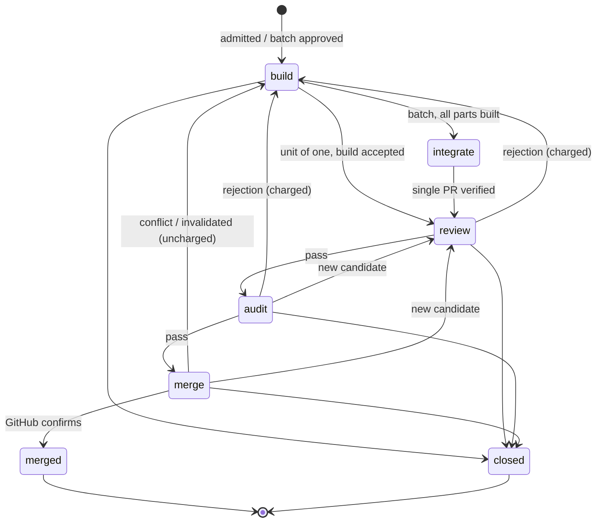

# State and units of work

**Status:** design proposal for operator review. No code changes yet.
**Scope:** move Forge's durable state from JSON files into SQLite. While doing so,
rebuild the issue lifecycle around **units of work** (one or more issues delivered
together, #207) and fix the lifecycle bugs found this week at their root.

**Related:** [issue state machine](../issue-state-machine.md),
[software factory contract](../software-factory-spec.md),
[factory runtime](../factory-runtime.md) and issue #207.

---

## 0. Summary

Today one JSON document, `state/factory/factory-ledger.json`, holds every issue,
job, event, slot and cooldown. On the live box it is **64.6 MB**. Every write
reloads it, serializes it twice to validate it, and rewrites it with fsync. That
costs about **1.4 s per write**, and about **0.7 s for each `Ledger.read()`**.
`supervisor.py` calls `ledger.read()` 47 times and opens 26 transactions of its own.
Finished jobs' logs make up 75% of the file.

The lifecycle has the same shape as the storage. An issue's real state is its
`state` field plus about 25 side fields: `operator_hold`, `environment_hold`,
`prerequisite_hold`, `blocked_dependencies`, `label_hold`, `ownership_wait`,
`merge_gate`, `retry_after`, `decision_request`, `verification_request`, and
others. Free text in `reason` fills the gaps. Three readers interpret those fields
independently, each with its own precedence: the supervisor, `presentation()` and
`attention_kind()`. Most of this week's bugs come from that.

The proposal:

1. **Separate the concepts.**
   - An **issue** is a GitHub fact.
   - A **unit of work** owns the branch, the candidate PR, the attempt budget and
     the pipeline stage.
   - A **job** is one worker run.
   - A **wait** is one coded reason why a unit cannot advance.

   A single issue is a unit of one, and a batch is a unit of several.
2. **Give a unit one closed state enum,** `build → integrate → review → audit →
   merge → merged | closed`. A transition table backs it, and both Python and a
   SQLite trigger enforce it. Every hold, gate and wait becomes a row in `waits`,
   with a `kind` and `code` from a closed registry. Each row records how it is
   released. Wording, attention codes and display precedence are derived from that
   registry, in one place.
3. **Store everything in one SQLite database,** `state/forge.db`.
   - It runs in WAL mode, with `BEGIN IMMEDIATE` for writers and snapshot reads
     for the API.
   - Constraints and partial unique indexes replace `Ledger.validate()`.
   - Logs move to a compressed `job_artifacts` table with a retention policy.
   - GitHub side effects go through an `outbox` that is written in the same
     transaction as the state change.
4. **Deliver it in six independently shippable PRs.** The first one alone
   removes about 80% of the write cost.

---

## 1. Lifecycle audit

### 1.1 Persisted states and their writers

`STATES` in `contracts.py` lists `ready`, `built`, `reviewed`, `audited`,
`approval_needed`, `investigating`, `hold`, `failed`, `merged` and `cancelled`.
`NEXT_ROLE` maps `ready→build`, `built→review` and `reviewed→audit`. Running is not
a state: it is `issue.active`, a pointer to a job, which can also be a `merge`
pseudo-job.

| Transition | Writer (file: function) |
| --- | --- |
| *(new)* → `ready` or `hold` | `ledger.discover_in` (`hold` if a hold label is present at discovery) |
| milestone → next milestone | `ledger.accept` via `PASS_STATE` |
| any → `investigating` or `failed` | `ledger.fail` (`failed` at 3 charged failures since `budget_start`) |
| `investigating` → `RETRY_STATE` stage or `hold` | `ledger.findings` (sets `hold` with `APPROACH_HOLD` on a repeated pattern) |
| `investigating`/`failed` → `built` | `ledger.recover_publication` (uncharges the failure) |
| `built`/`reviewed` → `approval_needed` | `ledger.request_verification` (stores `resume_state`) |
| `approval_needed` → `built`/`reviewed` | `ledger.complete_verification` |
| `audited` → `approval_needed` | `supervisor.merge` (direct dict edit; reason is free text) |
| `audited`/`approval_needed` → `ready` | `ledger.resolve_conflict` (uncharged; also fences a refused merge job, #183) |
| any → `ready`/`built`/`hold` | `ledger.invalidate`, `supervisor.pause_external_change` |
| `ready` → `ready` (+ dependency fields) | `ledger.wait_on_issues` |
| `ready` → `hold` (+ `decision_request`) | `ledger.request_decision` |
| any → `hold` (+ `environment_hold.state`) | `ledger.block_environment`; `ledger.resume_environment` restores the saved stage |
| `ready`/`built`/`reviewed` → `hold` (+ `prerequisite_hold.state`) | `ledger.pause_for_protection`; `ledger.resume_protection` restores it |
| any → `hold` | `ledger.hold` (labels, unknown outcome, host memory) |
| any → `hold` (+ `operator_hold`) | `issue_actions.decide` and `IssueActions.apply` for pause and backlog |
| `hold`/`failed`/`cancelled`/`approval_needed` → `ready` or saved stage | `ledger.retry`, **and separately** `issue_actions.decide` (queue, resume, retry, recheck, start_anyway) |
| any → `merged` | `supervisor.reconcile_current` (direct dict edit when GitHub reports the PR merged); `ledger.accept` for the merge job |
| any → `cancelled` | `ledger.cancel` (external closure, operator close; `closed_as` from GitHub's `state_reason`) |
| `hold` → `ready` (self-healing) | `reconcile_current` regex over recovery prose (#196) and over `decision_request` text (#174) |

**Holds and waits.** There are fourteen of them, recorded in eight different ways.

| Hold or wait | Recorded as | Set by | Released by | Budget |
| --- | --- | --- | --- | --- |
| Dependency | `blocked_dependencies`, `dependency_reason` (prose), `dependencies_checked_at`; `state` unchanged | `dependency_ready`, `wait_on_issues` | Fresh GitHub read shows the prerequisites closed; `start_anyway` for worker-declared ones | no |
| Ownership (#151) | `ownership_wait` = `{headline, plain}` (**prose is the state**) | `ownership_ready` | Automatic, when no claiming PR, human assignee or `wip` label remains | no |
| Label hold | `state=hold`, `reason` = one of **two** strings, `label_hold` list | `discover_in`, `reconcile_current` (×3), `dispatch` | Operator `resume` only. **Removing the label does not release it** | no |
| Operator pause or backlog | `state=hold`, `operator_hold={kind,state}` | `decide`, `apply` | `resume` or `queue` | no |
| Applying decision | `operator_sync`, `operator_request` | `decide`, `request` | `IssueActions.sync` once the labels are confirmed | no |
| Repository protection | `state=hold`, `prerequisite_hold={state}`, exact reason string | `pause_for_protection`, `migrate_protection_hold_in` | `resume_protection`, which needs the reason string to match | no |
| Environment | `state=hold`, `environment_hold={state,blocker,…}` | `block_environment` | `resume_environment` or `retry_services`/`retry_memory`, by blocker | no |
| Availability (account, GitHub) | `retry_after` plus `reason='blocked_auth'` (**a code in prose**) | `ledger.wait`, dispatch error paths | Time | no |
| Investigation | `state=investigating`, `failures[-1].investigation` | `fail` | `findings` | yes |
| Budget | `state=failed` | `fail` | Operator retry (resets `budget_start`) | — |
| Approach | `state=hold`, `reason == APPROACH_HOLD` (**string equality**) | `findings` | Operator retry, or the #196 regex | — |
| Decision | `state=hold`, `decision_request` | `request_decision` | Operator retry, or the #174 regex | no |
| Verification | `state=approval_needed`, `verification_request` | `request_verification` | `complete_verification` | no |
| Approval and merge gate (#140, #189, c060ff1) | `state=approval_needed`, `merge_gate={kind,reason}`, `reason` | `supervisor.merge` | A fresh observation passes every gate | no |
| Unknown outcome | `state=hold`, reason prose | `cycle()` after deadline + 900 s | Operator | no |

### 1.2 Findings: problem → root cause in the model

The **live** column comes from the read-only dry run against the live box
(section 6.2).

| # | Problem observed | Root cause in the model | Live |
| --- | --- | --- | --- |
| 1 | An issue can be `hold` **and** dependency-waiting **and** ownership-waiting at once. Each reader picks a different one. | Waits are independent side fields with no shared precedence. `state=hold` overloads six unrelated stop reasons. | 3 settled issues still carry `blocked_dependencies` |
| 2 | The supervisor and `presentation()` derive the same facts differently. `presentation()` checks labels before environment, decision and dependencies. `attention_kind()` returns `None` for any `blocked_dependencies` *before* it looks at a question or failure. The `hold` label is "waiting" in one and "attention" (`blocked`) in the other. Ownership, dependencies and readiness are recomputed from inventory copies, whereas the supervisor uses fresh reads. | No single function maps state to an explanation. The UI re-derives eligibility from raw fields, and the precedence is hand-coded in three places. | — |
| 3 | A stale inventory copy disagrees with the ledger. | `inventory.json` is a second copy of GitHub, refreshed only when a status API request (`legacy/forge-status.py`) calls `start_refresh()`. Supervisor observations don't update it, apart from the `github_observation` overlay on 14 issues. | Inventory was **6 h old**. 11 issues show open in the inventory but merged or cancelled in the ledger. |
| 4 | Free-text `reason` is used as a code. Examples: `reason == APPROACH_HOLD`, `LEGACY_SETUP_REASON`, `'Repository review settings need attention'`, `reason in ('blocked_auth','blocked_quota','Role credentials unavailable')`, `legacy_approval` matching on exact prose. Dispatch overwrites `reason` with `str(error)`. | There is no coded wait type. `reason` is both display text and control data. | 1 hold known only by its reason text |
| 5 | A label hold never releases when the label is removed, yet the UI says it will ("Forge leaves the issue alone until that label is removed"). | A label hold is written as `state=hold`, a terminal-ish stop. `reconcile_current` returns early for `hold` before it checks labels again. | 1 live issue in this state |
| 6 | Holds overwrite each other and lose the saved stage. `ledger.hold()` pops `environment_hold` and `prerequisite_hold`, so a resume falls back to `ready`. | The stage is stored inside each hold's dict (`{'state': …}`) instead of being kept while the hold is active. | — |
| 7 | A merge job pinned a conflicted candidate forever (#183). | `issue.active` points at both worker jobs and an external merge request. A refused merge has no completion path, so `active` stayed set. | 0 now (patched locally in `resolve_conflict` only) |
| 8 | Checks were left `in_progress` on stopped PRs (#194). `merge()` must "publish first" because a check "lost after the move would stay waiting forever". | GitHub side effects are not tied to transitions. They are best-effort calls placed around state edits, then patched by `checks_settled` bookkeeping. | — |
| 9 | Closed as completed outside Forge is recorded as `cancelled`. Activity's "completed" section mixes merged and cancelled. The Issues page splits `dropped` using `closed_as`. | `cancelled` conflates operator cancel, external completion and "not planned". `closed_as` (#174) is a patch on top of it. | 8 issues are `cancelled` with `closed_as=completed` |
| 10 | Residue fields survive transitions. | Every transition must remember to `pop()` each field. Nothing scopes a fact to a candidate or a stage. | 38 settled issues carry `merge_gate`; 17 carry `retry_after` |
| 11 | Self-healing regexes over worker prose (#174, #196). | Workers can't return a typed "waiting on #N". The build result can (`waiting_on_issues`), but recovery findings and decisions can't. | — |
| 12 | Failure data is stored three times. | `issue.failures[]` is copied into every job as `job.failure` and `job.history` at reservation. | 3.4 + 3.6 + 3.1 MB |
| 13 | **Write amplification.** Every observation, `last_observed` stamp and `provider_cooldowns` write (each cycle while a Codex login is bad, #189) rewrites 64.6 MB. | One document is the unit of locking and durability. | 1.4 s per write; jobs are 91% of the bytes |
| 14 | Logs are kept twice after a job finishes. | `job.observation.logs` (the live tail) is not dropped once `job.capture.logs` exists. | 20.2 MB of observation logs; 26.4 MB of capture logs |
| 15 | A crash during a rewrite leaves a 12 MB orphan. | `atomic_json` cleans up its temp file only in-process. | `.pending-1fh9yc66` dated Sep 29 |
| 16 | Decision idempotency scans all events (`decide()`). `event.sequence = len(events)+1`. | Events double as the request-id index, so they can never be pruned. | — |
| 17 | `Discussions.read()` takes a **write** transaction and rewrites `discussions.json` on every read. `IssueInventory.view()` scans all events and jobs per issue (O(issues × (events + jobs))). | The JSON stores have no read API and no indexes. | — |
| 18 | The retry transition is implemented twice: `Ledger.retry` and `issue_actions.decide`, plus `IssueActions.apply`. | Any caller may edit the dict, so transitions are not owned by one module. | — |

The pattern is the same throughout. Facts are stored as overlapping dict fields
with no owner, no scope and no closed vocabulary. JSON storage makes every edit
expensive and every derived view a full scan.

---

## 2. Model from first principles

### 2.1 Concepts

| Concept | What it is | Owns | Does not own |
| --- | --- | --- | --- |
| **Issue** | The GitHub fact: title, body, labels, assignees, open/closed, `state_reason`, dependencies stated in the body. Cached in one row. | Its GitHub status, its admission intent (queued or backlog) | Branches, budgets, pipeline stage |
| **Unit of work** | One or more issues delivered by one PR. A unit of one is the normal case. | Stage, branch, current candidate, attempt budget (`budget_epoch`), retry plan, environment choice, decision fence | GitHub facts |
| **Part** | A member issue inside a unit, with its own sub-branch in a batch | Part build status | The PR |
| **Job** | One worker run with a role, plus its outcome and failure accounting | Logs (as artifacts), result, `charged` | Unit state (it proposes; transition functions decide) |
| **Candidate** | One verified PR revision: head, base, requirements and policy digest | Evidence (review, audit), verifications, check runs, merge commit | — |
| **Wait** | One coded reason the unit cannot advance now | Its code, detail, since, until and release mode | Prose |
| **Decision** | One operator request, idempotent by request id | Action, reason, status | — |

Gates are evaluated **per unit**: dependencies, ownership, holds, repository
readiness, account availability, human approval. A gate that holds is
materialized as a `waits` row, and clears by setting `cleared_at`. A job never
moves the unit directly. Its outcome is handed to a transition function, which
changes `units.state` and the `waits` rows in one transaction.

### 2.2 Unit state machine

`units.state` is a closed enum and is always the **next pipeline step**. A
stopped unit keeps its stage; the stop is a wait. This removes every saved
`{'state': …}` copy.

| State | Meaning | Next job |
| --- | --- | --- |
| `build` | Parts need building, or rebuilding | `build`, one per pending part |
| `integrate` | Batch only: every live part is built and the batch branch and PR need assembling | `integrate` |
| `review` | The current candidate needs review | `review` |
| `audit` | The current candidate needs audit | `audit` |
| `merge` | Technical gates have passed; the supervisor evaluates the merge gate and merges | none (a supervisor merge request) |
| `merged` | Terminal: GitHub confirmed the candidate merged | — |
| `closed` | Terminal, with `close_code`: `dropped`, `closed_on_github`, `cancelled`, `dissolved`, `superseded` | — |

| From → to | Trigger | Function | Budget |
| --- | --- | --- | --- |
| *(new)* → `build` | Issue admitted (ready label or `queue`) or batch approved | `units.admit`, `batches.approve` | new epoch |
| `build` → `review` | Build accepted and candidate verified (unit of one) | `pipeline.accept` | — |
| `build` → `integrate` | Last live part built (batch) | `pipeline.accept` | — |
| `integrate` → `review` | Integration accepted and the single PR verified | `pipeline.accept` | — |
| `review` → `audit` | Review passed for the current candidate | `pipeline.accept` | — |
| `audit` → `merge` | Audit passed | `pipeline.accept` | — |
| `review`/`audit` → `build` or `integrate` | Rejection | `pipeline.fail(rejection=True)` | charged |
| `merge` → `build` or `integrate` | Conflict with base | `pipeline.conflict` | uncharged |
| `review`/`audit`/`merge` → `build` | Requirements, base or policy changed | `pipeline.invalidate` | uncharged |
| `audit`/`merge` → `review` | Head replaced by a new valid candidate | `pipeline.invalidate(candidate=…)` | uncharged |
| `merge` → `merged`, or any open state → `merged` | GitHub confirms the candidate merged (Forge's or external) | `pipeline.merged` | — |
| any open state → `closed` | All members closed on GitHub, operator close, dissolve, or absorbed into a batch | `pipeline.close(code)` | — |

An execution failure keeps the state and adds an `investigation` wait.
Verification requests add a `verification` wait **on the current stage**; the
stage's job reruns once the wait clears. That is exactly today's `resume_state`
behavior, without the copy.

Terminal states are terminal. Resuming a closed unit creates a **new** unit, which
inherits the branch through the existing-draft logic (`own_draft`). That matches
today's budget reset on retry.



Python owns the transition table (`pipeline.TRANSITIONS`). It is also seeded into
`unit_transitions` and enforced by a trigger, so a stray `UPDATE` cannot create an
illegal state.

### 2.3 Waits: one registry, one precedence, one wording

`forge/factory/codes.py` defines every wait kind and code. It replaces the string
comparisons, `SUMMARIES` keys, `attention_kind()` and the hold branches of
`presentation()`. The `waits.kind` and `waits.code` columns have a foreign key to
the seeded `wait_codes` table, so an unknown code cannot be written.

| Kind | Codes | Release | Attention | Blocks |
| --- | --- | --- | --- | --- |
| `applying` | `labels` | auto, when the outbox confirms the labels | — | dispatch |
| `external_change` | `pr_edited`, `outcome_unknown`, `legacy_hold` | operator `recheck` | `review` | everything |
| `decision` | `question` | operator answer | `question` | dispatch |
| `budget` | `exhausted` | operator `retry` (new epoch) | `failed` | dispatch (recovery still runs) |
| `approach` | `repeated_failure` | operator `retry` with an approach | `approach` | dispatch |
| `environment` | `toolchain`, `sandbox`, `dependency_access`, `resources`, `ci_evidence`, `services`, `host_memory` | auto recheck by code, or operator `recheck` | `env` | dispatch |
| `repository` | `protection_missing`, `bypass_missing`, `access_missing`, `disabled` | auto, when the repository observation is `ready` | `env` | dispatch and merge |
| `verification` | `human`, `ci` | auto, on a fresh approval or a CI pass for this candidate | `verify` / — | stage job |
| `approval` | `human_required` | auto, on a counted approval | `approve` | merge |
| `merge_blocked` | `changes_requested`, `gates_mismatch`, `ci_failed`, `unresolved_human_requirement`, `refused` | auto | `review` | merge |
| `operator` | `pause`, `backlog` | operator `resume` or `queue` | — | dispatch |
| `label_hold` | `hold`, `blocked` | **auto, when the label is removed** | — | dispatch and merge |
| `ownership` | `assignee`, `wip_label`, `claiming_pr` | auto | — | dispatch and merge |
| `dependency` | `open_prerequisite` (detail: numbers, source `body` or `declared`) | auto; `start_anyway` for `declared` | — | dispatch |
| `investigation` | `pending` | auto, when the recovery job ends | — | stage job |
| `backoff` | `account_auth`, `account_quota`, `github_unavailable`, `environment_selection` | auto, at `until` | — | dispatch |

The table's order **is** the display precedence. Several waits may be active at
once, and all of them are shown. The headline is the first. A unit can therefore
honestly be "paused by a label *and* waiting for #17". Both clear independently,
and clearing one never erases the other.

`status.describe(unit, waits, live_job, issue)` derives the plain wording, the UI
status (`working`, `attention`, `waiting`, `blocked`, `queued`) and the
`attention_kind` from the registry. The supervisor's eligibility check and the
UI call the same function. Worker prose stays in `waits.detail.note` and in job
summaries; it is never compared.

**Typed results replace the self-healing regexes (#174, #196).** The `recovery`
and `build` result schemas (`ROLE_FIELDS`) gain `blocked_by: [issue numbers]`.
A result that carries it becomes a `dependency/open_prerequisite` wait with
`source=declared`. The regexes in `reconcile_current` remain only as a
**migration** rule for legacy holds.

### 2.4 Issue-level status

This is derived in a SQL view, `issue_status`, and never stored.

| Status | Rule |
| --- | --- |
| `done` | Member of a `merged` unit, or closed on GitHub with `state_reason` `completed` or null |
| `dropped` | Closed as `not_planned` or `duplicate`, with no merged unit |
| `in_unit` | Open, with a membership row whose `left_at IS NULL` |
| `queued` | Open, admitted (ready label or `queue` decision) but not in a unit yet, for example before the next cycle |
| `untracked` | Everything else (today's "backlog") |

A partial unique index allows at most one open membership per issue, so an issue
is never in two units.

### 2.5 Where each fact lives

| Today (ledger field) | New home | Notes |
| --- | --- | --- |
| `state` | `units.state` + active `waits` | — |
| `reason` | `waits.code` + `waits.detail` | Prose only in `detail.note` |
| `active` | `jobs WHERE unit_id=? AND cleanup=0`; `merge_requests` | No pointer to keep in sync |
| `candidate` | `candidates`, `units.candidate_id` | — |
| `failures`, `budget_start`, `job.failure`, `job.history` | `jobs.charged`, `jobs.budget_epoch`, `jobs.investigates`, `jobs.findings`; `units.budget_epoch` | History is a query; the launch input is kept as an artifact |
| `evidence`, `verified_checks`, `verification_request`, `merge_gate.approvals` | `evidence`, `verifications`, `candidate_observations`, keyed by `candidate_id` | Scoped to the candidate, so no clearing is needed |
| `requirements`, `title`, `github_observation`, inventory rows | `issues` (one row, newest `observed_at` wins) | Inventory and supervisor share it |
| `blocked_dependencies`, `dependency_reason`, `declared_dependencies`, `dependency_body`, `dependency_evidence`, `dependencies_checked_at` | `issue_dependencies` + `waits(dependency)` | Wording derived |
| `ownership_wait` | `waits(ownership)` with a structured detail (`login`, `pr`) | — |
| `label_hold` | `issues.labels` → `waits(label_hold)` | — |
| `operator_hold`, `operator_sync`, `operator_request`, `actions.json`, `operator-requests.json`, `check-requests.json` | `decisions`, `waits(operator \| applying)`, `outbox` | — |
| `environment_hold`, `prerequisite_hold` | `waits(environment \| repository)` | The saved stage disappears |
| `environment_choice`, `_override`, `_retry`, `_label`, `memory_retry` | `units.environment` (JSON) | `environment_label_pending` becomes the outbox |
| `decision_request` | `waits(decision).detail` | — |
| `checks_settled` | `check_runs` + `outbox` | — |
| `last_summary` | The latest job summary for the unit | Derived |
| `retry_after` | `waits(backoff).until` | — |
| `closed_as` | `issues.state_reason` | — |
| `deployed`, `deploy_failed` | `candidates.deployed_at`, `candidates.deploy_failed` | — |
| `last_observed`, `settled_observed`, `budget_interruptions` | `units.observed_at`, `units.observe_interruptions` | — |
| `decision_version` | `units.decision_version` | — |
| Ledger `slots` | `jobs.slot` + partial unique index | — |
| `provider_cooldowns`, `provider_retry_after`, `provider_cursor`, `memory_profiles`, `discovery_observed` | `provider_cooldowns`, `kv`, `memory_profiles`, `repositories.discovered_at` | — |
| `discussions.json` | `discussion_threads`, `discussion_messages`; discussion runs become `jobs(role='discussion')` | `reserve_logins` becomes one query |

---

## 3. SQLite schema

The schema is condensed here; the full DDL lives in
`forge/store/schema/001_initial.sql`. Timestamps are `REAL` epoch seconds, as
today, and JSON columns hold JSON text.

```sql
CREATE TABLE repositories (
  id INTEGER PRIMARY KEY,                       -- GitHub repository id
  name TEXT NOT NULL, target_branch TEXT, discovered_at REAL,
  readiness TEXT NOT NULL DEFAULT 'unknown' CHECK (readiness IN
    ('unknown','ready','protection_missing','bypass_missing','bypass_unknown','access_missing','disabled')),
  readiness_report TEXT, readiness_observed_at REAL,   -- protections() + controller_bypass(), read once
  collaborators TEXT, collaborators_at REAL);

CREATE TABLE issues (                           -- the only copy of GitHub issue facts
  repo_id INTEGER NOT NULL REFERENCES repositories, number INTEGER NOT NULL CHECK (number > 0),
  title TEXT NOT NULL, body TEXT NOT NULL DEFAULT '', body_hash TEXT NOT NULL,
  body_truncated INTEGER NOT NULL DEFAULT 0,
  gh_state TEXT NOT NULL CHECK (gh_state IN ('open','closed')),
  state_reason TEXT CHECK (state_reason IN ('completed','not_planned','duplicate','reopened')),
  labels TEXT NOT NULL DEFAULT '[]', assignees TEXT NOT NULL DEFAULT '[]', label_events TEXT,
  admitted TEXT CHECK (admitted IN ('queued','backlog')),   -- ready label or operator intent
  updated_at TEXT, observed_at REAL NOT NULL,
  PRIMARY KEY (repo_id, number)) WITHOUT ROWID;

CREATE TABLE issue_dependencies (
  repo_id INTEGER NOT NULL, number INTEGER NOT NULL, prerequisite INTEGER NOT NULL,
  source TEXT NOT NULL CHECK (source IN ('body','declared')),
  body_hash TEXT NOT NULL, evidence TEXT,          -- valid while issues.body_hash matches
  PRIMARY KEY (repo_id, number, prerequisite, source),
  FOREIGN KEY (repo_id, number) REFERENCES issues) WITHOUT ROWID;

CREATE TABLE pull_requests (
  repo_id INTEGER NOT NULL, number INTEGER NOT NULL, title TEXT, body TEXT, branch TEXT, author TEXT,
  gh_state TEXT NOT NULL, forge_owned INTEGER NOT NULL DEFAULT 0,
  claims TEXT NOT NULL DEFAULT '[]',              -- issue numbers per claims_issue(), computed on write
  observed_at REAL NOT NULL, PRIMARY KEY (repo_id, number)) WITHOUT ROWID;

CREATE TABLE units (
  id INTEGER PRIMARY KEY, repo_id INTEGER NOT NULL REFERENCES repositories,
  kind TEXT NOT NULL CHECK (kind IN ('single','batch')),
  state TEXT NOT NULL CHECK (state IN ('build','integrate','review','audit','merge','merged','closed')),
  close_code TEXT CHECK (close_code IN ('dropped','closed_on_github','cancelled','dissolved','superseded')),
  target_branch TEXT NOT NULL, branch TEXT,
  candidate_id INTEGER REFERENCES candidates DEFERRABLE INITIALLY DEFERRED,
  budget_epoch INTEGER NOT NULL DEFAULT 0, retry_plan TEXT, environment TEXT,
  decision_version INTEGER NOT NULL DEFAULT 0,
  created_by TEXT NOT NULL CHECK (created_by IN ('discovery','operator','supervisor','import')),
  created_at REAL NOT NULL, closed_at REAL, observed_at REAL,
  observe_interruptions INTEGER NOT NULL DEFAULT 0,
  UNIQUE (id, repo_id),
  CHECK ((state IN ('merged','closed')) = (closed_at IS NOT NULL)),
  CHECK ((state = 'closed') = (close_code IS NOT NULL)),
  CHECK (kind = 'batch' OR state <> 'integrate'));
CREATE INDEX units_open ON units(state, observed_at) WHERE closed_at IS NULL;
CREATE INDEX units_done ON units(closed_at DESC, id DESC) WHERE closed_at IS NOT NULL;

CREATE TABLE unit_transitions (from_state TEXT, to_state TEXT, PRIMARY KEY (from_state, to_state)) WITHOUT ROWID;
CREATE TRIGGER unit_state_machine BEFORE UPDATE OF state ON units
WHEN OLD.state <> NEW.state AND NOT EXISTS
  (SELECT 1 FROM unit_transitions WHERE from_state = OLD.state AND to_state = NEW.state)
BEGIN SELECT RAISE(ABORT, 'illegal unit transition'); END;

CREATE TABLE unit_issues (                      -- membership and batch parts
  unit_id INTEGER NOT NULL, repo_id INTEGER NOT NULL, number INTEGER NOT NULL,
  part_branch TEXT,
  part_state TEXT NOT NULL DEFAULT 'pending' CHECK (part_state IN ('pending','built','dropped')),
  joined_at REAL NOT NULL, left_at REAL,
  left_reason TEXT CHECK (left_reason IN ('merged','closed','dropped','dissolved','superseded')),
  PRIMARY KEY (unit_id, repo_id, number),
  FOREIGN KEY (unit_id, repo_id) REFERENCES units(id, repo_id),     -- same repository only
  FOREIGN KEY (repo_id, number) REFERENCES issues) WITHOUT ROWID;
CREATE UNIQUE INDEX one_open_unit_per_issue ON unit_issues(repo_id, number) WHERE left_at IS NULL;

CREATE TABLE candidates (
  id INTEGER PRIMARY KEY, unit_id INTEGER NOT NULL REFERENCES units,
  key TEXT NOT NULL UNIQUE, pr INTEGER NOT NULL, branch TEXT NOT NULL,
  head TEXT NOT NULL, base TEXT NOT NULL, base_ref TEXT NOT NULL,
  build_job TEXT NOT NULL REFERENCES jobs, summary TEXT,
  accepted_at REAL NOT NULL, superseded_at REAL, merge_commit TEXT,
  deployed_at REAL, deployed_via TEXT, deploy_failed TEXT);
CREATE TABLE evidence (candidate_id INTEGER NOT NULL REFERENCES candidates,
  role TEXT NOT NULL CHECK (role IN ('review','audit')), outcome TEXT NOT NULL, job_id TEXT REFERENCES jobs,
  human_required TEXT CHECK (human_required IN ('required','not_required')), human_reason TEXT,
  summary TEXT, at REAL NOT NULL, PRIMARY KEY (candidate_id, role)) WITHOUT ROWID;
CREATE TABLE verifications (id INTEGER PRIMARY KEY, candidate_id INTEGER NOT NULL REFERENCES candidates,
  job_id TEXT REFERENCES jobs, request TEXT NOT NULL, ci TEXT,
  status TEXT NOT NULL CHECK (status IN ('pending','complete','void')), proof TEXT,
  created_at REAL NOT NULL, verified_at REAL);
CREATE TABLE candidate_observations (candidate_id INTEGER PRIMARY KEY REFERENCES candidates,
  approvals TEXT, mergeable INTEGER, observed_at REAL NOT NULL);   -- last merge-gate read
CREATE TABLE check_runs (candidate_id INTEGER NOT NULL REFERENCES candidates,
  name TEXT NOT NULL CHECK (name IN ('review','audit','controller')),
  status TEXT NOT NULL CHECK (status IN ('in_progress','success','failure','neutral')),
  summary TEXT, published_at REAL, PRIMARY KEY (candidate_id, name)) WITHOUT ROWID;
CREATE TABLE merge_requests (id INTEGER PRIMARY KEY, unit_id INTEGER NOT NULL REFERENCES units,
  candidate_id INTEGER NOT NULL REFERENCES candidates, requested_at REAL NOT NULL,
  result TEXT CHECK (result IN ('merged','refused','superseded')), detail TEXT, finished_at REAL);
CREATE UNIQUE INDEX one_open_merge ON merge_requests(unit_id) WHERE result IS NULL;

CREATE TABLE jobs (
  id TEXT PRIMARY KEY CHECK (length(id) = 36),
  unit_id INTEGER REFERENCES units, part_number INTEGER, thread_number INTEGER,
  role TEXT NOT NULL CHECK (role IN ('build','integrate','review','audit','recovery','discussion')),
  stage TEXT, candidate_id INTEGER REFERENCES candidates,
  slot TEXT, provider TEXT, provider_id TEXT, model TEXT, publisher TEXT,
  branch TEXT, resume_branch TEXT, resume_pr INTEGER, target_branch TEXT,
  policy TEXT, requirements TEXT, runner_config TEXT,
  phase TEXT NOT NULL CHECK (phase IN ('reserved','preparing','running','stopping','cleaned')),
  outcome TEXT CHECK (outcome IN ('accepted','failed','investigated','blocked_environment','waiting',
    'waiting_on_issues','needs_decision','needs_human_verification','memory_retry','services_retry',
    'superseded','cancelled','held','external_merge')),
  fenced INTEGER NOT NULL DEFAULT 0, cleanup INTEGER NOT NULL DEFAULT 0, cancelled INTEGER NOT NULL DEFAULT 0,
  charged INTEGER NOT NULL DEFAULT 0, budget_epoch INTEGER, cause TEXT, retry_stage TEXT,
  investigates TEXT REFERENCES jobs, findings TEXT, correction TEXT, summary TEXT,
  created_at REAL NOT NULL, deadline REAL, last_observed REAL, finished_at REAL,
  CHECK ((role = 'discussion') = (unit_id IS NULL)),
  CHECK (cleanup = 0 OR fenced = 1),
  CHECK (charged = 0 OR outcome = 'failed'));
CREATE UNIQUE INDEX one_job_per_slot  ON jobs(slot) WHERE cleanup = 0 AND slot IS NOT NULL;
CREATE UNIQUE INDEX one_live_job_part ON jobs(unit_id, ifnull(part_number, 0)) WHERE cleanup = 0 AND unit_id IS NOT NULL;
CREATE UNIQUE INDEX one_investigation ON jobs(investigates) WHERE investigates IS NOT NULL AND outcome IS NOT 'waiting';
CREATE INDEX jobs_by_unit ON jobs(unit_id, created_at DESC);
CREATE INDEX jobs_open    ON jobs(last_observed) WHERE outcome IS NULL;

CREATE TABLE job_artifacts (                    -- large and private: logs and raw results, kept apart
  job_id TEXT NOT NULL REFERENCES jobs ON DELETE CASCADE,
  kind TEXT NOT NULL CHECK (kind IN ('logs','live_tail','result','input','ci_evidence','teardown')),
  encoding TEXT NOT NULL DEFAULT 'zlib', bytes INTEGER NOT NULL, body BLOB NOT NULL, created_at REAL NOT NULL,
  PRIMARY KEY (job_id, kind)) WITHOUT ROWID;

CREATE TABLE wait_codes (kind TEXT, code TEXT, release TEXT NOT NULL, attention TEXT,
  precedence INTEGER NOT NULL, PRIMARY KEY (kind, code)) WITHOUT ROWID;   -- seeded from codes.py
CREATE TABLE waits (
  id INTEGER PRIMARY KEY, unit_id INTEGER NOT NULL REFERENCES units,
  kind TEXT NOT NULL, code TEXT NOT NULL, detail TEXT NOT NULL DEFAULT '{}',
  since REAL NOT NULL, until REAL, recheck_after REAL,
  cleared_at REAL, cleared_by TEXT CHECK (cleared_by IN ('auto','operator','supervisor','transition')),
  decision_id TEXT REFERENCES decisions,
  FOREIGN KEY (kind, code) REFERENCES wait_codes);
CREATE UNIQUE INDEX one_active_wait_kind ON waits(unit_id, kind) WHERE cleared_at IS NULL;

CREATE TABLE decisions (                        -- replaces actions.json, operator/check requests, operator_request
  id TEXT PRIMARY KEY,                          -- the client's request id: idempotency without scanning events
  repo_id INTEGER NOT NULL, number INTEGER, unit_id INTEGER REFERENCES units,
  action TEXT NOT NULL CHECK (action IN ('queue','backlog','pause','resume','retry','recheck','start_anyway',
    'assign_reviewer','environment','close','check','stop','reset','combine','approve_batch','reject_batch',
    'drop_part','dissolve')),
  reason TEXT NOT NULL, revision TEXT, payload TEXT,
  status TEXT NOT NULL CHECK (status IN ('pending','applied','rejected')), error TEXT,
  created_at REAL NOT NULL, applied_at REAL);
CREATE UNIQUE INDEX one_pending_decision ON decisions(repo_id, number) WHERE status = 'pending' AND number IS NOT NULL;

CREATE TABLE outbox (                           -- GitHub side effects, written in the same transaction
  id INTEGER PRIMARY KEY, unit_id INTEGER REFERENCES units, repo_id INTEGER NOT NULL,
  kind TEXT NOT NULL CHECK (kind IN ('labels','check','settle_checks','close_issue','comment',
    'request_reviewers','environment_label','close_pr')),
  dedupe TEXT NOT NULL, payload TEXT NOT NULL,
  created_at REAL NOT NULL, next_at REAL NOT NULL, attempts INTEGER NOT NULL DEFAULT 0,
  done_at REAL, error TEXT);
CREATE UNIQUE INDEX outbox_pending ON outbox(dedupe) WHERE done_at IS NULL;   -- the latest intent wins

CREATE TABLE events (
  id INTEGER PRIMARY KEY AUTOINCREMENT,         -- monotonic, never reused after pruning
  at REAL NOT NULL, repo_id INTEGER, number INTEGER, unit_id INTEGER, job_id TEXT,
  kind TEXT NOT NULL, code TEXT, data TEXT NOT NULL DEFAULT '{}');
CREATE INDEX events_unit  ON events(unit_id, id);
CREATE INDEX events_issue ON events(repo_id, number, id);
CREATE TRIGGER events_append_only BEFORE UPDATE ON events BEGIN SELECT RAISE(ABORT, 'events are append-only'); END;

CREATE TABLE batch_proposals (id INTEGER PRIMARY KEY, repo_id INTEGER NOT NULL, target_branch TEXT NOT NULL,
  members TEXT NOT NULL, rationale TEXT NOT NULL,
  proposed_by TEXT NOT NULL CHECK (proposed_by IN ('operator','supervisor')),
  status TEXT NOT NULL CHECK (status IN ('pending','approved','rejected','expired')),
  unit_id INTEGER REFERENCES units, decision_id TEXT REFERENCES decisions,
  created_at REAL NOT NULL, decided_at REAL);

CREATE TABLE discussion_threads (repo_id INTEGER NOT NULL, number INTEGER NOT NULL, status TEXT NOT NULL,
  origin TEXT, reason TEXT, presence TEXT, partial TEXT, job_id TEXT REFERENCES jobs, updated_at REAL NOT NULL,
  PRIMARY KEY (repo_id, number)) WITHOUT ROWID;
CREATE TABLE discussion_messages (id INTEGER PRIMARY KEY, repo_id INTEGER NOT NULL, number INTEGER NOT NULL,
  sequence INTEGER NOT NULL, author TEXT NOT NULL, text TEXT NOT NULL, at REAL NOT NULL, data TEXT,
  UNIQUE (repo_id, number, sequence));

CREATE TABLE provider_cooldowns (provider TEXT PRIMARY KEY, until REAL NOT NULL,
  reason TEXT NOT NULL CHECK (reason IN ('blocked_auth','blocked_quota')), detail TEXT, since REAL, job_id TEXT);
CREATE TABLE memory_profiles (repo_id INTEGER, role TEXT, memory TEXT NOT NULL, job_id TEXT, at REAL,
  PRIMARY KEY (repo_id, role)) WITHOUT ROWID;
CREATE TABLE deployments (repo_id INTEGER PRIMARY KEY, observed TEXT NOT NULL, at REAL NOT NULL);
CREATE TABLE kv (name TEXT PRIMARY KEY, value TEXT NOT NULL, updated_at REAL NOT NULL);  -- supervisor lease, cursor
CREATE TABLE migrations (step TEXT PRIMARY KEY, source_digest TEXT, done_at REAL NOT NULL);
```

**Views** keep the derivations in one place: `issue_status` (section 2.4),
`dispatchable` and `unit_failures`. For example:

```sql
CREATE VIEW dispatchable AS
SELECT u.* FROM units u
WHERE u.state IN ('build','integrate','review','audit')
  AND NOT EXISTS (SELECT 1 FROM waits w WHERE w.unit_id = u.id AND w.cleared_at IS NULL
                  AND (w.until IS NULL OR w.until > unixepoch('subsec')))
  AND NOT EXISTS (SELECT 1 FROM jobs j WHERE j.unit_id = u.id AND j.cleanup = 0);
-- unit_failures: COUNT(*) FROM jobs WHERE unit_id = ? AND charged AND budget_epoch = units.budget_epoch
```

**How `Ledger.validate()` maps to the schema.**

| Invariant in `validate()` | Replaced by |
| --- | --- |
| `item['state'] in STATES` | `CHECK` on `units.state` + the transition trigger |
| `0 <= budget_start <= len(failures)` | `budget_epoch` integer; failures are rows |
| `active` exists and belongs to the issue | No `active` pointer; `one_live_job_part`, `one_open_merge` |
| `job.role` valid; `job.issue_key` exists | `CHECK`, foreign key |
| A slot points to exactly one uncleaned job | `one_job_per_slot` partial unique index |
| A finished job holds no slot | Same index (`WHERE cleanup = 0`) |
| JSON serializable, no NaN | `CHECK (json_valid(col))` on JSON columns (omitted above for brevity) |

### 3.1 Connections and transactions

- **Pragmas on every connection:**
  - `journal_mode=WAL` (persistent);
  - `foreign_keys=ON`;
  - `busy_timeout=5000`;
  - `synchronous=FULL`, which keeps today's fsync durability (measured at 1.6 ms
    per commit on the live disk; `NORMAL` measured 0.1 ms);
  - `journal_size_limit=67108864`;
  - `auto_vacuum=INCREMENTAL`, set at creation.
- **Writers use `BEGIN IMMEDIATE`.** It takes the write lock up front, so a deferred
  read never fails later while upgrading to a write. Write transactions contain
  **no network or container calls**. The pattern is:
  1. read a snapshot;
  2. call GitHub or the runner outside any transaction;
  3. open a short write transaction that re-checks its preconditions with
     compare-and-set (`UPDATE … WHERE id=? AND decision_version=? AND state=?`,
     then check `rowcount`).

  `Ledger.observing()` and `DecisionChanged` become that check, and no longer
  re-read 64 MB.
- **Readers use a deferred `BEGIN`.** All `SELECT`s for one API response run inside
  one read transaction, so they see one WAL snapshot. Readers never block the
  writer, and the writer never blocks readers. API connections set
  `PRAGMA query_only=ON`. There is one connection per thread
  (`threading.local`), since `setup_service` is threaded.
- **Processes.** The supervisor, the API (`setup_service`) and the CLI open the
  same file on one host. WAL needs a local filesystem; `state/` already is one.

### 3.2 File, permissions, backups, retention

- **Location.** The database is `<root>/state/forge.db`, with `-wal` and `-shm`
  beside it.
  - `state/` stays `0700`, and the files are `0600` (`os.umask(0o077)` before
    the first connect).
  - Opening refuses a symlink (an `lstat` check, as in `AtomicStore._load`).
  - The file is never mounted into workers.
  - `state/forge.initialized`, together with `PRAGMA user_version`, keeps the
    fail-closed rule: an initialized but missing database is an error, never a
    blank start.
- **Secrets stay out.** `operator-auth`, `credentials`, `job-secrets` and
  `*.secret` stay files. Job logs remain best-effort redacted private data, as
  today.
- **Backups.**
  - The online backup API (`connection.backup`) writes to
    `state/backups/forge-<UTC>.db` (`0600`):
    - daily;
    - before every schema migration;
    - before every `host_update` deploy.
  - Retention: keep 7 daily and 4 weekly backups.
  - Each backup is verified with `PRAGMA integrity_check`.
  - The supervisor lease (`controller_lock`) is not needed; the backup is an
    online snapshot.
- **Retention.**

| Data | Policy |
| --- | --- |
| `job_artifacts.live_tail` | Deleted when the job finishes; `logs` supersedes it (today's 20 MB of duplicate observation logs) |
| `job_artifacts.logs`, `ci_evidence`, `input` | Kept 30 days after the job finishes, then deleted |
| `job_artifacts.result`, `jobs.summary`, `findings` | Kept forever (small) |
| Events: transitions, decisions, merges | Kept forever |
| Events: telemetry (`runner_released`, `availability_wait`, `dependencies_checked`, `ownership_changed`, `environment_recheck`) | Pruned after 90 days |
| `outbox` done rows | Pruned after 14 days |

  Pruning runs once a day in its own small transactions, followed by
  `PRAGMA incremental_vacuum`. Event ids stay monotonic because of
  `AUTOINCREMENT`. Idempotency lives in `decisions`, so pruning events never
  breaks it.

---

## 4. Access layer

### 4.1 Shape

```text
forge/store/db.py        connect(), pragmas, migrations (user_version), backup(), retention()
forge/store/repos.py     Issues, Units, Members, Jobs, Artifacts, Waits, Decisions, Outbox, Events, Threads
                         row-level reads/writes only; no lifecycle rules
forge/factory/codes.py   wait registry (kind, code, release, attention, precedence, wording)
forge/factory/pipeline.py  the ONLY writer of units.state and waits: transition functions
forge/factory/status.py  describe(): one derivation for supervisor eligibility and UI
```

```python
store = Store(root)
with store.read() as r:                       # BEGIN; one WAL snapshot
    unit = r.units.get(unit_id); waits = r.waits.active(unit_id)
with store.write() as w:                      # BEGIN IMMEDIATE … COMMIT (rollback on exception)
    w.units.fence(unit_id, decision_version=v)          # raises DecisionChanged
    pipeline.accept(w, job_id, candidate=fresh, evidence=None, summary=card)
    # inside: CAS on jobs.outcome IS NULL, insert candidate, set unit.state,
    # clear transition-scoped waits, append event, enqueue outbox('labels'), all atomic
```

**Ledger methods become pipeline functions.** Each has a one-to-one replacement,
so phase 3 can keep the names.

| `Ledger` method | `pipeline` function | Behavior change |
| --- | --- | --- |
| `discover`, `discover_in` | `units.admit` / `issues.upsert` | A hold label becomes a `label_hold` wait, not `state=hold` |
| `reserve` | `jobs.reserve` | Slot and part uniqueness come from indexes; provider cursor in `kv` |
| `job_update`, `release` | `jobs.observe`, `jobs.release` | Observation goes to `job_artifacts.live_tail`, one row |
| `accept`, `fail`, `findings`, `recover_publication` | same names | Failures are job rows; findings set the `approach` or `budget` wait |
| `resolve_conflict`, `invalidate` | `pipeline.conflict`, `pipeline.invalidate` | They also close any open `merge_requests` row |
| `request_verification`, `complete_verification` | same names | A `verification` wait on the current stage; no `resume_state` |
| `wait_on_issues`, `request_decision` | same names | `dependency` and `decision` waits |
| `block_environment`, `resume_environment`, `retry_memory`, `retry_services` | same names | An `environment` wait; the stage is untouched |
| `wait` | `pipeline.backoff` | A `backoff` wait plus a `provider_cooldowns` upsert |
| `hold`, `pause_for_protection`, `resume_protection`, `migrate_protection_hold*` | `waits.set` / `waits.clear` with typed codes | The legacy migration happens once, in the importer |
| `cancel` | `pipeline.close(code)` | `close_code` comes from `state_reason`; `completed` maps to `closed_on_github` |
| `retry` **and** `issue_actions.decide` retry path | `pipeline.retry` (single implementation) | New `budget_epoch`; clears `budget`, `approach` and `decision` waits |
| `deployed`, `deploy_failed`, `merge_commit` | `candidates.*` | — |

### 4.2 Callers

- **Supervisor cycle (`supervisor.cycle`).**
  - `execution()` writes one artifact row per live job, instead of rewriting the
    ledger.
  - The observation loop is `SELECT … FROM units WHERE closed_at IS NULL ORDER BY
    priority, observed_at LIMIT n`. Settled units leave the rotation; a reopened
    issue is found by discovery and creates a new unit.
  - `reconcile(unit)` reads GitHub and **upserts the `issues` and `pull_requests`
    rows**, so the inventory is current for every observed issue. It then calls
    `pipeline.observe(w, unit, facts)`. That one transaction sets or clears the
    `dependency`, `ownership`, `label_hold`, `repository` and `merge_blocked`
    waits from facts, and enqueues labels.
  - `dispatch()` becomes `SELECT … FROM dispatchable ORDER BY created_at`.
  - A new `drain_outbox()` step publishes labels, checks, closures and settled
    checks, with retries, and records `check_runs`.
  - `check_logins()` upserts `provider_cooldowns` only when the value changes.
- **`issue_actions`.**
  - `decide()` inserts into `decisions`. The request id is the primary key, so
    idempotency costs nothing.
  - It then calls the pipeline function (`retry`, `pause`, `resume`, …) and
    enqueues label changes in the same transaction.
  - `operator_sync` and `operator_request` become a pending decision plus an
    `applying` wait.
  - `IssueActions.process()` drains pending decisions that need GitHub first
    (assign reviewer, environment, close).
- **`discussions`.** Threads and messages become rows. `read()` is a read
  transaction, `send()` inserts one message, and presence is one column update.
  `reserve_logins` and `active_jobs` become one query on
  `jobs WHERE role='discussion' AND cleanup=0`.
- **Status API** (`legacy/forge-status.py` and `setup_service`).
  - `control.view` runs three indexed queries in one snapshot: open units with
    their headline wait, the latest 6 jobs per unit, and the last 3 events per unit.
  - `select_view(section='completed')` becomes keyset paging on `units_done`
    (`WHERE (closed_at, id) < (?, ?)`).
  - `IssueInventory.view` joins `issues`, `issue_status`, the open unit, its
    active waits and `status.describe()`. Filtering by status, searching
    (`LIKE`), ordering and the 50-row pages all run in SQL.
  - `presentation()` shrinks to formatting `describe()` and actions. Its precedence
    chain, legacy approval string match and reason-code sniffing are deleted.
- **CLI.** `forge factory stop|reset|retry` insert decisions. New commands:
  `forge state import|parity|export|backup|check`.
- **View cache (#172).** `fingerprint()` stats six directories on every request,
  and `MAX_AGE` exists because rebuilding was expensive. With indexed queries
  (0.3 ms for the whole open board on live data), the cache is unnecessary for
  correctness and speed. Keep only the HTTP `ETag`/304 path, keyed by a cheap
  revision (`SELECT max(id) FROM events` plus the `PRAGMA data_version` of the
  serving connection). Delete `ViewCache.get` once phase 4 ships.

---

## 5. Batches and units of work (#207)

The model above already contains most of #207. These are the flows.

1. **Proposal.**
   - The operator ("Combine into one PR…") or the supervisor (on by default)
     writes a `batch_proposals` row.
   - The supervisor proposes only units in `build` with no candidate, in the same
     repository and target branch, linked by a label, a parent issue or a
     prerequisite chain, or small enough together. There is no size cap.
   - **Validation, at proposal and again at approval:**
     - every member is open;
     - no member has an `ownership`, `label_hold` or `operator` wait;
     - every prerequisite is either a member or closed;
     - there is no prerequisite cycle among the members;
     - no member has a live job.
2. **Approval.** This is one write transaction, and the batch unit gets a fresh
   epoch.
   - Each member's unit of one closes with `close_code=superseded`
     (`left_reason=superseded`).
   - A `kind='batch'` unit is created in `build` with branch `forge/batch-<id>`.
   - Members join with `part_branch=forge/batch-<id>/issue-<n>`. A member's
     existing candidate branch is reused as its part branch.
   - The supervisor's proposals become decisions (`approve_batch` or
     `reject_batch`), never applied silently.
3. **Parallel part builds.**
   - Each pending part gets a `build` job (`jobs.part_number`). The jobs run in
     parallel within Build slots.
   - `one_live_job_part` allows one live job per part, instead of one per issue.
   - A part whose in-batch prerequisite part is not `built` is not dispatchable.
     This is a scheduling rule in `dispatchable`, not a wait, because nothing
     external is awaited.
4. **Integration.**
   - When every non-dropped part is `built`, the unit moves `build → integrate`.
   - The `integrate` job merges the part branches into the batch branch, resolves
     conflicts, runs the repository's checks and opens or updates **one PR**.
   - The PR body has `Closes #a`, `closes #b`… for each member, plus submission
     marker **version 2**: `{"version": 2, "unit": id, "issues": [...],
     "attempt", "head"}`. `contracts.submission()` accepts v1 and v2.
   - The candidate is verified against every member's requirements digest.
5. **Review, audit, approval and merge, once.**
   - These steps apply unchanged to the one candidate.
   - Evidence may attribute findings to members (`evidence.detail.members`).
   - `ownership()` must treat the unit's own batch PR as the candidate for every
     member. Without that, the batch PR's closing keywords would trip the #151
     ownership rule.
6. **Shared budget.**
   - Charged failures of part builds, integration, review and audit all count
     against the unit's single `budget_epoch` (3).
   - A rejection returns to `build` with `retry_plan` routed to the named parts
     (`part_state` back to `pending`). Recovery may set `retry_stage=integrate`
     when only the integration is at fault.
   - A conflict with base returns to `integrate`, uncharged.
   - Once the budget is exhausted, there is a `budget` wait, and the operator
     chooses between retry, dropping a part and dissolving.
7. **Dropping a part.**
   - The `drop_part` decision sets `part_state=dropped` and `left_at`, and starts
     a new unit of one for that issue with the part branch as its resume branch.
   - If a candidate exists, the unit returns to `integrate` (uncharged), so the PR
     loses that member's closing keyword.
   - A part never blocks the others without an explicit operator choice, as
     #207's acceptance criteria require.
8. **Dissolving.** The `dissolve` decision closes the unit (`dissolved`), comments
   on and closes the batch PR through the outbox, and creates units of one for
   every remaining member, each keeping its part branch. Events and jobs stay
   attached to the closed batch unit for history.
9. **Gating.**
   - External prerequisites of any member form the unit's `dependency` wait (the
     union, minus members).
   - Ownership, label holds and operator pauses on **any** member gate the whole
     unit, and the wait detail names the member.
   - Repository readiness and account availability apply per unit, as today.
10. **Merge.**
    - `pipeline.merged` sets `left_reason=merged` for every member and enqueues
      `close_issue` for members GitHub did not close itself (non-default target
      branches).
    - Deployment observation attaches to the candidate, so every member shows as
      deployed.

---

## 6. Migration

### 6.1 Import

`forge state import` is one-time, resumable and idempotent.

1. **Take a lock and a backup.** Hold the controller lock, with the supervisor
   paused. Copy every source JSON file to `state/backups/json-<UTC>/` (`0600`) and
   record each file's sha256 in `migrations.source_digest`.
2. **Import in steps.** The steps are `repositories`, `issues` (inventory plus the
   ledger's GitHub overlay), `units`, `jobs`+`artifacts`, `events`,
   `decisions`, `discussions`, `cooldowns`/`profiles`/`kv`.
   - Each step runs in its own transaction and is recorded in `migrations`.
   - A rerun skips completed steps.
   - Natural keys (job uuid, `(repo_id, number)`, request id) make reinsertion
     `INSERT OR IGNORE`.
3. **Map legacy state to units of one** (in phase 5; phases 2–4 import the
   ledger's shape).

| Legacy state | `units.state` | Waits created |
| --- | --- | --- |
| `ready` / `built` / `reviewed` / `audited` | `build` / `review` / `audit` / `merge` | From the side fields: `blocked_dependencies`, `ownership_wait`, `retry_after` |
| `approval_needed` + `verification_request` | `resume_state` → `review` or `audit` | `verification` |
| `approval_needed` | `merge` | `approval` or `merge_blocked`, from `merge_gate.kind` |
| `investigating` | The pending failure's `retry_state` | `investigation` |
| `failed` | The last failure's `retry_state` | `budget` |
| `hold` | The saved stage from `operator_hold`, `environment_hold` or `prerequisite_hold` `.state`, else `build` | `decision` / `approach` (`APPROACH_HOLD`) / `environment` / `repository` / `operator` / `label_hold`; anything else becomes `external_change/legacy_hold`, with the reason kept in `detail.note` |
| `merged` | `merged` | — |
| `cancelled` | `closed`, with `close_code` from `closed_as`: `completed` → `closed_on_github`, `not_planned`/`duplicate` → `dropped`, none → `cancelled` | — |

### 6.2 Dry run against the live box

The dry run used a private copy under `/tmp` (`0700`). It ran under `nice 19`
while the service was live, and the copy was deleted afterwards. Only counts,
sizes and timings were printed. Root: `/home/luc/ops/forge-watchdog`,
2026-10-05.

| Source | Size | Rows |
| --- | --- | --- |
| `factory-ledger.json` | **64.6 MB** | 112 issues, 878 jobs, 3,135 events, 0 live slots |
| ├ `jobs` | 58.7 MB (91%) | `capture` 28.4 MB (logs 26.4), `observation` 20.4 MB (logs 20.2), `failure` 3.6, `history` 3.1, `runner_config` 1.1, `ci_evidence` 0.9 |
| ├ `issues` | 4.1 MB | `failures` 3.4 MB, `evidence` 0.4 MB |
| └ `events` | 1.5 MB | Largest kinds: `assigned` 791, `runner_released` 791, `accepted` 415; at most 129 per issue |
| `issues/inventory.json` | 2.5 MB | 8 repositories, 1,010 issues, 12 PRs |
| `deployments.json` | 0.45 MB | — |
| `issues/discussions.json` | 0.17 MB | 7 threads, 17 messages |
| `issues/actions.json` | 0.07 MB | 17 requests (11 applied, 6 rejected) |
| Orphan `.pending-1fh9yc66` | 12.1 MB | A leftover from an interrupted rewrite on Sep 29 |

| Measurement | JSON today | SQLite prototype |
| --- | --- | --- |
| Parse the ledger | 0.43 s | — |
| Validate (full `json.dumps`) | 0.25 s, ×2 per transaction | Constraints, per row |
| Rewrite + fsync | 0.52 s | — |
| **One write transaction** | **≈1.4 s** | **1.6 ms** (`synchronous=FULL`), 0.1 ms (`NORMAL`) |
| One `ledger.read()` | ≈0.7 s | Snapshot `SELECT`s |
| Full open-board query (112 units + 6 jobs + 3 events each) | Whole-file parse | **0.3 ms** |
| Import time | — | 1.7 s |
| Database size | 64.6 MB | **34.3 MB**: artifacts zlib 48.8 → 11.3 MB (13.8 MB on disk); jobs 10.9; issues 3.4; units 4.2; events 1.8 |
| **Round-trip parity** | — | **0 mismatches** over 112 issues and 878 jobs (artifacts reattached); 3,135 events equal |

**Artifact age.** Of the artifact bytes:

- 6.2 MB are less than a day old;
- 11.3 MB are 1–7 days old;
- 29.1 MB are 7–14 days old;
- 2.1 MB are 14–30 days old.

The proposed 30-day log retention changes nothing yet. Dropping `live_tail` on
finish saves 20 MB, and compression saves another 37 MB. With slimmed `jobs`
columns (no `failure` or `history` copies), the steady-state database should be
about 15 MB.

**Lifecycle overlaps found in live data** (they confirm section 1.2):

- 11 issues are open in the inventory but settled in the ledger, with the
  inventory 6 h old;
- 8 issues are `cancelled` with `closed_as=completed`;
- 38 settled issues carry a stale `merge_gate`;
- 17 settled issues carry `retry_after`;
- 3 settled issues carry `blocked_dependencies`;
- 1 issue is held only by a label, recorded as `state=hold` with no typed hold
  field.

The prototype schema (units, jobs, artifacts, events, issues) is simplified. The
importer in phase 2 targets the full schema.

### 6.3 Parity before cut-over

`forge state parity` builds `control.view(root)` and `IssueInventory.view()` for
every filter and page, plus `discussions.view` for every thread, from **both**
backends, and diffs them row by row on `key`.

- **Phases 2–4** must show zero diffs, apart from a short allow-list of
  intended fixes (for example, inventory staleness). It runs in CI on fixture
  ledgers that cover every hold kind, and nightly on a copy of the live state
  (the same `/tmp` procedure as 6.2).
- **Cut-over gate:** 7 consecutive days of clean nightly parity.
- **Phase 5** changes the semantics, so its parity compares
  `status.describe()` with today's `presentation()` and reviews each difference
  by hand. Every difference must map to a row of the table in 1.2.

### 6.4 Rollback

- **Through phase 4:** the runtime setting `state_backend: json | sqlite` selects
  the backend. `forge state export` writes `factory-ledger.json` and the other
  stores back from SQLite. This is lossless, because the model is unchanged up to
  phase 4. The original JSON files stay read-only in the backup directory for 30
  days.
- **After phase 5:** export maps units of one back to legacy states (the reverse
  of 6.1). It refuses while a batch is open: dissolve batches first, then roll
  back.
- **Corrupt database:** restore the latest verified backup, then run the existing
  "reconcile before recovery" procedure. The supervisor re-observes GitHub, and
  jobs are reconciled from their containers.

---

## 7. Phased delivery

Each phase is a small, mergeable PR with no flag day.

| # | PR | Size | Main risks | Tests |
| --- | --- | --- | --- | --- |
| 1 | **Store foundation and artifact offload.** Add `forge/store/db.py` (pragmas, permissions, migrations, backup). Move `capture`, `observation`, `ci_evidence` and `history` to `job_artifacts`, behind `Ledger.artifact(job_id, kind)`. The ledger keeps everything else. Clean up `.pending-*` on start. | M | Two stores are not atomic. Write the artifact before the ledger reference, and treat a missing artifact as "logs unavailable", never as an error. Old ledgers carry the fields inline (read both). | Store unit tests (permissions, symlink refusal, WAL, busy timeout); existing `tests/test_factory_*` unchanged; a size regression test (ledger size independent of job logs on a fixture with 1,000 jobs). **Expected effect on live: 64.6 → ≈12 MB, so roughly 80% less time per write.** |
| 2 | **Full schema, importer and parity (no behavior change).** `forge state import --dry-run\|--apply`, `forge state parity`, `forge state export`. | M | Mapping gaps in rarely used fields. Mitigated by the field census in 2.5 and the round-trip check. | Golden fixtures for every state and hold kind; import → export round trip byte-equal after normalization; nightly parity on a live copy. |
| 3 | **Supervisor on SQLite.** Reimplement `Ledger` methods on rows (same names). Replace the 26 direct transactions in `supervisor.py`, the 16 in `issue_actions.py` and the 13 in `discussions.py` with named repository or pipeline calls. Flag `state_backend`. | L | Concurrency between processes; long transactions accidentally wrapping GitHub calls (lint: no network inside `store.write()`); semantic drift. | Full suite parametrized over both backends; a two-process writer contention test; crash-injection tests (kill between statements, then assert the old or new state); a cycle-time benchmark on the replay (target: < 2 s of the 42 s cycle spent in storage). |
| 4 | **API and UI on SQL.** `control.view`, `IssueInventory.view` and `discussions.view` move to indexed queries with SQL paging. The inventory refresh and supervisor observations write the same `issues` rows. Retire `ViewCache.get` and keep ETag. | M | Response shape drift visible in the UI. | API snapshot tests (identical JSON to the JSON backend); a performance test (all views < 50 ms on a 10k-issue fixture); the existing UI end-to-end tests. |
| 5 | **Units of one, waits and codes.** Add `units`, `unit_issues`, `waits`, `codes.py`, `status.describe()` and the outbox. Migrate legacy holds. Delete `attention_kind()`'s and `presentation()`'s precedence chains, the reason-string comparisons and the #174/#196 regexes. Typed `blocked_by` in results. Label holds release automatically. | L | Operator-visible behavior changes (label release, `done` vs `cancelled`); migration of `legacy_hold`. | A transition-table property test (every illegal pair raises, in Python and through the trigger); migration fixtures from each legacy state; wording snapshots per wait code; the "both hold and dependency" regression; outbox retry and dedupe tests (checks settle after a crash between the state change and publishing). |
| 6 | **Batches (#207).** Operator "Combine" first (6a). Then supervisor proposals, on by default with approval (6b). Part builds, integration role, submission v2, drop part, dissolve, batch view. | L | Integration-role prompt quality; ownership of members through the batch PR; review cost of large diffs (no cap). | End-to-end runs on a fixture repository: two members built in parallel, one PR with both closing keywords, merge closes both; drop part; dissolve keeps branches; an internal prerequisite orders the parts; an external prerequisite gates the unit. |

Phase 1 is independent and delivers most of the performance win. Phases 2 to 4
change storage only. Phase 5 changes the lifecycle on a stable store, and phase 6
adds batches with no further schema change.

---

## 8. Open questions for the operator

1. **Label holds.** Should removing the `hold` or `blocked` label on GitHub resume
   the issue by itself? Proposed: **yes**. Today it doesn't, although the UI says
   it does.
2. **Closed as completed outside Forge.** Should this show as `done` rather than
   `cancelled`? Proposed: **yes**, with `close_code=closed_on_github`.
3. **Repository readiness.** Should a unit resume automatically when protection or
   bypass becomes ready? Today it needs a recheck. Proposed: **automatic**.
4. **Retention.** Keep logs for 30 days and results and summaries forever?
   Should telemetry events be pruned after 90 days?
5. **Durability.** Use `synchronous=FULL` (1.6 ms per commit, today's guarantees)
   or `NORMAL` (0.1 ms; may lose the last commit on power loss, never corrupts)?
   Proposed: `FULL`.
6. **Batch membership.** May the supervisor propose only candidate-less units,
   while the operator may also combine units that already have a PR (that PR is
   then closed as superseded)?
7. **Rollback window.** Keep the JSON backend and export for 30 days after phase
   4, and drop them in phase 5?
