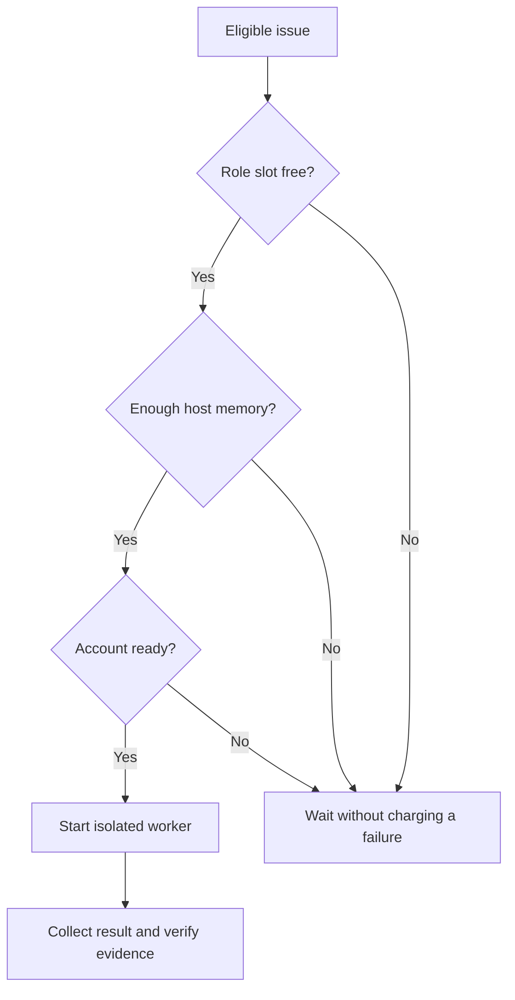
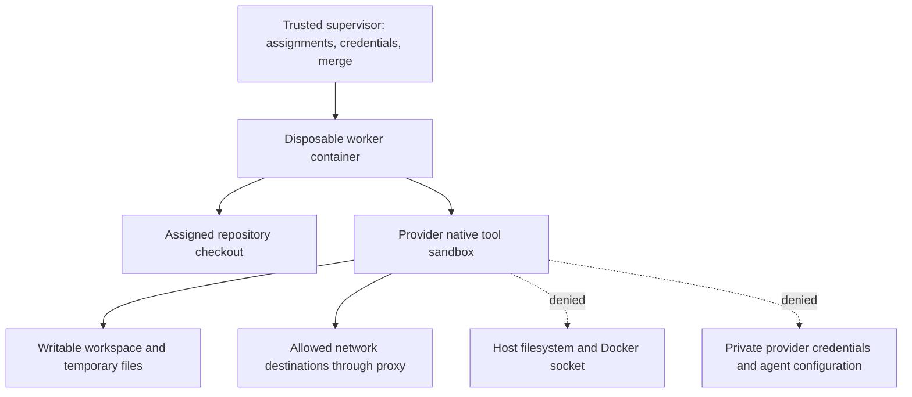
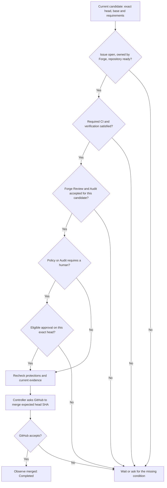

# Workers, accounts and merging

Forge starts disposable workers when a role slot, enough memory and a usable coding account are all available. A finished worker supplies evidence; the supervisor checks that evidence and GitHub again before the issue can advance or merge.




## Workers and slots

**Build** owns implementation and the assigned pull request. For an approved group,
one logical builder plans tracked tasks, releases its planning lease, then
resumes integration after accepted outputs and verified task cleanup. A task may
cover several issues, and several tasks may contribute to one issue. The builder
can execute a prerequisite task itself, delegate it to a child, or keep work for
final integration. Every task uses an isolated checkout and exact prerequisite
outputs. Independent tasks and separate deliveries share the same role slots,
memory and account limits.
**Review** checks the complete candidate, **Audit** checks security, and
**Recovery** investigates a failed attempt before the next decision.

The default role limits are 4 Build, 2 Review, 1 Audit and 1 Recovery worker. Those are ceilings, not a promise that eight workers will run: memory and accounts may admit fewer.

Each worker normally gets 4 GiB of memory and two CPUs. Forge reserves host memory before starting work and keeps 2 GiB for the host; adding slots alone does not create more memory.

Use **Settings → Worker capacity** to inspect the configured capacity. When an issue waits, read its reason rather than increasing every limit.

## What a worker can reach



Repository commands run inside the provider's native sandbox as well as the container boundary. Workers get their own workspace and limited network access; they do not get the host's Docker socket or the Controller credential.

A singleton builder or grouped integration execution receives repository-scoped
write access. Group planning, owner and child tasks, and repository triage receive
read-only GitHub tokens; tasks return local Git bundles. Only final integration
can publish the grouped candidate. Review, Audit and
Recovery also receive read-only access. The supervisor independently checks
evidence and publishes role verdicts with the appropriate App. Untracked native
provider delegation is disabled; the supported fallback is Forge-managed children.

The current production runner requires Linux, Docker and the installed isolation policies. If a project needs unavailable tools or a database environment, Forge reports a setup problem instead of treating it as a code defect.

For exact mounts, network rules and limits, read the [runtime reference](factory-runtime-reference.md) and [isolation reference](isolation.md).

## Accounts and cooldowns

Coding accounts authenticate the model providers. They are separate from the GitHub Apps that access repositories, and from your operator sign-in.

Open **Settings → Coding accounts** to connect or repair an account using the displayed host instructions. Workers receive the selected account for their assignment; repository tool commands cannot read its private credential files.

A quota or sign-in problem can make an account unavailable. Forge shows the reason and, when known, when it can retry; waiting for a provider does not charge the issue a failed code attempt.

Connected accounts may answer discussions too. Signing out of Forge revokes external agent connections you approved; it does not uninstall the repository GitHub Apps.

## What permits a merge



Repository setup is also a delivery blocker. Implementation admission uses the
same repository identity, App connection revision and fresh protection report
shown in Settings. A missing controller bypass, an unavailable check or an
expired report shows **Repository setup** on the affected issues, with a link to
repair or recheck the repository. The ordinary setup refresh and issue
observation clear this blocker after verified readiness; independent holds stay
in place. Dispatch saves its final protection read through that same report
boundary, so a newly discovered failure is visible immediately.

This readiness check does not change repository permissions or enablement.
Protection report expiry does not revoke a running worker or its output. New
work waits, and publication/merge retain their live policy checks. Auxiliary
repository planning and failure diagnosis require access, without requiring
publication readiness; loss of access still blocks them.

A green worker result alone is not merge permission. Forge checks its App-bound Review and Audit evidence, required CI, verification, repository protections and current ownership; unresolved changes requested also prevent merging.

Merge policy is set per repository and defaults to `human`, which requires one counted approval. Explicit `auto` permits a merge after CI, Review and Audit pass; Audit or verification can still require human approval. Settings shows the effective policy read-only. A counted review must come from an eligible person with repository write access (and the configured reviewer list, if any); bots and the pull request author do not count.

The approval must follow acceptance of the current candidate and match its exact head commit. The issue panel shows the reviews found and whether each counted.

Changes to the head, base, requirements or policy invalidate earlier candidate evidence. Forge reads approvals again just before merging and sends GitHub the expected head SHA, so a new commit cannot slip through using an old approval.

Set or inspect the policy through the CLI:

```sh
forge connect https://forge.example --repo OWNER/REPO --policy
forge repo policy OWNER/REPO --server https://forge.example
forge repo policy OWNER/REPO auto --server https://forge.example
forge repo policy OWNER/REPO human --server https://forge.example
```

The connection approval explicitly includes permission to set merge policy.
Existing connections keep their previously approved permissions. The policy is
stored by GitHub repository ID, so a rename does not transfer it to another
repository. The global merge switch remains a separate prerequisite.

On upgrade, an enabled legacy automatic-merge setting is preserved only for
already configured repository IDs. Other existing repositories and all new
repositories require human approval unless explicitly configured otherwise.
Changing a repository's effective policy invalidates its previous candidate
evidence; changing another repository's policy does not.

### Why the Controller has a bypass

GitHub's review baseline requires two approvals, but Forge's read-only Review and Audit workers do not submit native approving reviews. The Controller's configured pull-request bypass lets it merge after the supervisor independently verifies the role evidence and any required human approval.

That bypass covers its ruleset, so keep the baseline separate from stronger CI or organization protections. GitHub makes the final merge decision; see [Getting set up](onboarding.md#github-repository-protection) before changing review rules.

## Pause, cleanup and retries

Pausing prevents new work and can fence active assignments. A late worker result cannot authorize progress after its assignment was withdrawn; cleanup must still finish.

A disappeared or stopped worker is not automatically a code failure. Forge distinguishes infrastructure problems from charged failures and investigates each charged failure, including the third.

An approved delivery shares three charged failures across its builder and children.
Changing membership does not silently reset that budget. After exhaustion, read the findings and record a new approach before choosing an explicit retry. **Discuss blocker** is available for understanding the problem without spending another failure attempt.

See [How an issue moves](issue-state-machine.md) for status meanings. Technical settings, deadlines, storage retention and pre-cutover behavior are in the [runtime reference](factory-runtime-reference.md); a selected SQLite installation uses forward updates and has no JSON switch-back.

### Forge startup problems

**Forge needs a repair** means an image-owned harness failed before the agent
started. These verified import, name and syntax errors consume no issue attempts.
Forge retains the failure evidence and waits for a qualified replacement image.

The normal updater qualifies each replacement before activating it. Once every
affected worker image has changed, Forge releases this blocker and checks whether
work can resume. Other holds still apply. A configuration-only or same-image
update does not retry the fault.

This handling currently covers ordinary build, review and audit assignments.
The broader failure envelope and **Report to Forge** action are still planned.
See the [startup protocol and scope](factory-runtime-reference.md#forge-startup-problems)
for technical details.
