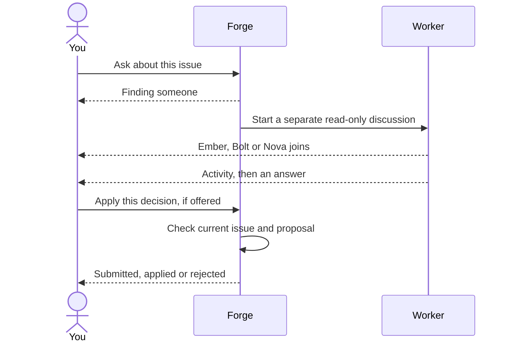
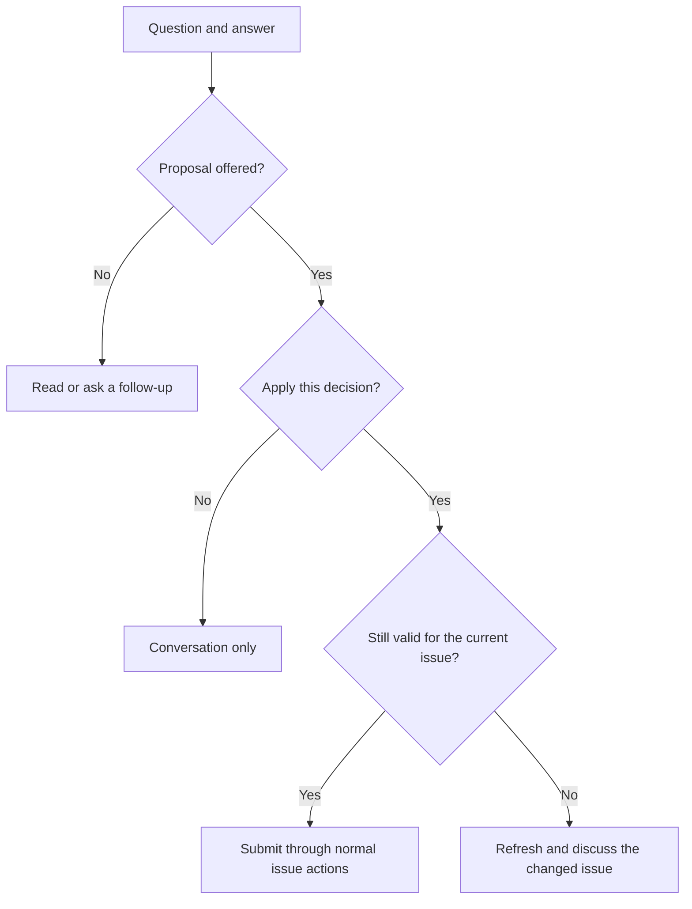

# Talking to a worker

Use **Discuss blocker** to ask about an issue without starting another implementation attempt. A worker reads the saved evidence, explains what it found and may offer a decision; only your explicit **Apply this decision** asks Forge to change anything.

## Meet the workers

**Ember** is Claude, **Bolt** is Codex and **Nova** is Grok. The name tells you which provider is answering; it does not mean the same process has been running between messages.

Forge prefers the last attempt's provider when it is available. Another connected provider can step in, and the conversation shows the change.

## Ask a useful question

Open an issue and choose **Discuss blocker**, or open its **Discussion** tab. Ask one concrete question, such as “Which test failed?”, “What needs a human check?” or “What would a different approach change?”

The worker gets the issue, current candidate, recent attempt summaries and recent conversation. This is reconstructed context, not a live attachment to the original worker; it cannot recover an unsaved private conversation.

While an answer is on its way:

- **Finding someone** means no discussion worker has started yet. The reason may be capacity, productive work going first, a pause or an account cooldown.
- A named worker **joins** when its container starts. One live line shows what it is doing now, updated in place.
- The answer replaces that line. A worker that left before someone else answered leaves no trace.
- If a worker leaves and nobody answers, the thread says why. Use **Try again** when offered; an interrupted answer is not a completed decision.

You can leave and return to the saved conversation. Older messages remain readable, although only a bounded recent portion is sent with the next question.

## Apply a proposal deliberately

Read the proposed action and reason before applying it. A submitted action can still be pending or rejected: the controller checks the current issue, requirements and permissions again.

If the issue or pull request changed, an old proposal may no longer apply. Refresh the issue and ask about the new evidence instead of repeatedly submitting the old decision.

If the agent proposes something Forge does not offer on this issue, its answer still arrives, without a button, noting that the action isn't available here.

## Close an issue from the conversation

Whenever the issue can be closed, **Close issue** is one of the decisions the agent may propose, with a one-sentence reason. Its card opens the usual Close dialog with that reason filled in; nothing closes until you confirm.

When you ask in so many words ("close this issue"), the agent closes it for you in that turn, through the same path as the button and as you: Forge closes its pull request and closes the issue on GitHub as not planned, with the agent's reason as the comment. The reply says it is closed and offers **Undo**, which reopens the issue on GitHub; Forge's next look returns it to the board. The issue's history records that the close came from the discussion, quoting your message. The agent never closes on its own initiative, and no other decision is applied this way.

Discussion does not approve a merge, waive a security check or edit the repository. Its separate, read-only worker does not consume the issue's failure attempts, but does use provider capacity and usage.

## If nobody joins

Check the displayed reason first. Resume Forge if paused, repair an account in **Settings → Coding accounts**, or wait for the shown cooldown or available memory.

Only one discussion worker runs at a time, and productive pipeline work gets priority. A queued or running discussion has a ten-minute limit; a timeout or restart is recorded in the thread so an unanswered question does not appear successful.

For what happens after a decision, see [How an issue moves](issue-state-machine.md). For capacity and credentials, see [Workers, accounts and merging](factory-runtime.md); developers can follow the [conversation implementation reference](issue-conversations-reference.md).
