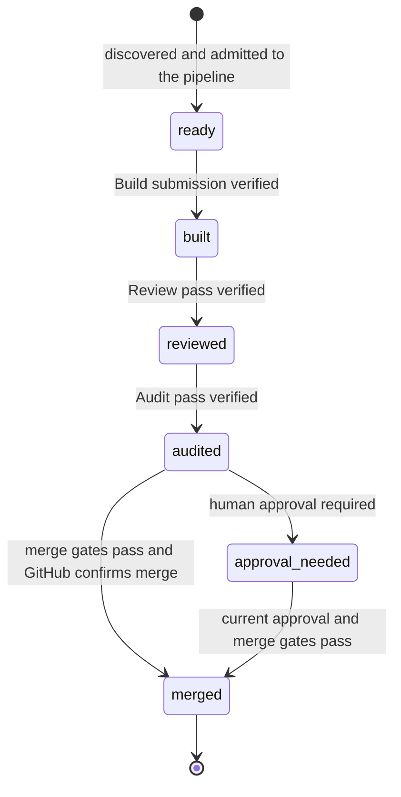
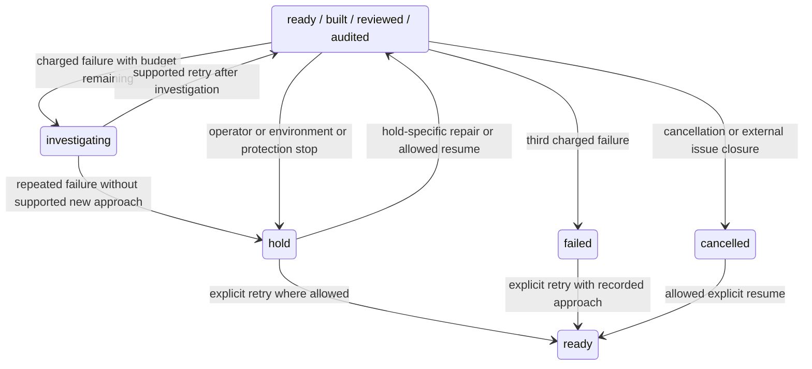
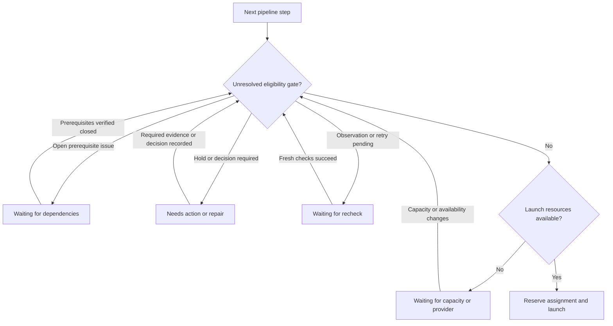

# Issue state machine

This page describes the **current durable factory** in `forge/factory`, including
why an issue can have no worker while its pipeline stage is `ready`.
Open **Help → Issue states and blockers** in Forge, or start here when the
Activity page appears stuck. The
[software factory contract](software-factory-spec.md) defines evidence and authority;
[runtime setup](factory-runtime.md) covers admission and resources.

A builder that needs an operator choice can [request a decision](build-decisions.md)
without publishing a PR or consuming a failure attempt. Database availability is
handled through [job environments](job-environments.md), including a bounded retry
and an operator hold when the full environment is still insufficient.

## Pipeline progress and permission to run

Forge records two separate facts:

- **Pipeline state:** the last accepted milestone or an explicit stop condition.
- **Dispatch eligibility:** whether the next step may start now, after checking
  dependencies, holds, cleanup, repository access, provider availability and capacity.

There is currently **no `blocked` or `waiting_for_dependencies` value** in the
persisted issue-state enum. Unmet issue dependencies are stored in
`blocked_dependencies`, with a readable `dependency_reason`. For example:

```json
{
  "state": "ready",
  "blocked_dependencies": [17],
  "dependency_reason": "Waiting for #17."
}
```

This means “the next stage is Build, but issue #17 must close first.” It does not
mean a worker is available, reserved, or even eligible to start. Closing the
prerequisite removes that gate on a subsequent successful reconciliation; all
other gates still apply. Waiting consumes no coding-failure budget.

**Current UI limitation:** Activity counts these issues as queued and can say
“waiting for a worker.” That label does not reflect scheduler eligibility. The
scheduler already refuses dependency-blocked work; the UI projection needs to
make that distinction visible.

## Persisted issue states

The authoritative enum and next-role mapping are in
[`contracts.py`](../forge/factory/contracts.py). Transitions are implemented by
[`ledger.py`](../forge/factory/ledger.py),
[`supervisor.py`](../forge/factory/supervisor.py), and
[`issue_actions.py`](../forge/factory/issue_actions.py).

| State | Meaning | What can move it forward? |
| --- | --- | --- |
| `ready` | Build is the next stage; a build may already be active. | Eligible Build publishes an independently verified candidate. |
| `built` | Candidate accepted; Review is next or active. | Verified Review pass for the current candidate. |
| `reviewed` | Review accepted; Audit is next or active. | Verified Audit pass for the current candidate. |
| `audited` | Technical audit accepted; merge gates remain. | Supervisor verifies checks, protection and human policy, then confirms merge. |
| `approval_needed` | Current candidate needs a human decision. | Supervisor observes the required current GitHub approval and rechecks merge gates. |
| `investigating` | A charged attempt failed; Recovery investigates. | Findings allow a retry at the appropriate milestone or require a hold. |
| `hold` | Explicit operator, environment, protection or recovery stop. | The hold-specific repair/recheck or an allowed operator decision. |
| `failed` | Three charged failures exhausted the current budget. | Explicit retry with a recorded approach and fresh eligibility checks. |
| `merged` | GitHub confirms the accepted candidate merged. | Terminal for pipeline work; deployment is observed separately. |
| `cancelled` | Work cancelled, including an issue closed externally without an observed candidate merge. | An allowed explicit operator decision can return it to eligibility checks. |

Running is represented by the assigned job and its execution phase, not by
additional `building`, `reviewing` or `auditing` issue states. Finishing a process
is not evidence of a successful stage. Merge and deployment are separate facts.

### Main path

Arrows below require independently verified evidence. Dispatch itself leaves the
issue at its current milestone until the job's result is accepted.



Discovery can also place an issue directly on `hold`, for example when existing
work requires explicit adoption. A changed candidate, base, requirements or policy
can invalidate evidence and return work to an earlier milestone or a reconciliation
hold. An externally confirmed candidate merge is reconciled even after a failure;
an external issue closure without that merge is reconciled as cancellation.

### Failure, recovery and holds

This diagram groups the four retry milestones to keep recovery readable; it does
not add a `milestone` state to the ledger.



The current factory counts **charged failures across roles**, not just rejected
build cycles. A code rejection retries Build (`ready`); execution failure retries
the failed role's milestone after investigation. A third charged failure enters
`failed`; its investigation may still record findings but does not reset the budget.
Repeated failures can stop earlier on `hold` when there is no supported new approach.

Provider unavailability and dependency waits do not consume that budget. Validated
memory exhaustion can retry the same stage at a larger configured memory tier;
other validated environment blockers enter a typed hold, preserving the stage and
candidate. See [runtime setup](factory-runtime.md) for memory and automatic rechecks.
An unrelated dependency closing never clears an explicit hold or failed budget.

## Dispatch eligibility

This conceptual diagram describes the gates, not an additional persisted state
machine or the exact order of every scheduler check. Gates can coexist.



| Gate | Evidence or recorded field | How it clears |
| --- | --- | --- |
| Issue dependency | `blocked_dependencies`, `dependency_reason` | Fresh GitHub reads verify each prerequisite closed. |
| Explicit stop | `hold`, `failed`, `approval_needed` and their reasons | Appropriate decision or verified repair; no blanket retry. |
| Environment or repository protection | `environment_hold`, `prerequisite_hold` | Hold-specific recheck or allowed resume; saved stage retained. |
| Pending operator action | `operator_request` | Finish applying the durable decision before scheduling. |
| Old execution still owns resources | Active job or unverified cleanup | Verified cleanup before a replacement job. |
| Temporary availability | `retry_after`, provider cooldown/readiness, observation errors | Retry interval and fresh successful availability checks. |
| Dispatch disabled or repository unavailable | Runtime and repository admission settings | Enable dispatch or restore required access/settings. |
| Worker capacity | Role slots, memory admission, provider credential lease | Resources become available; no failure charged for waiting. |

Dependencies are declared in individual issue-body lines using `Depends on: #17`,
`Blocked by #17`, or `Dependency: #17`. Only same-repository issue references are
supported. A downstream `Blocks:` clause, general references and fenced examples
are excluded. An unreadable prerequisite is not assumed closed. Dependency cycles
and references to intentionally parked issues require correcting the requirements;
adding worker slots cannot resolve them.

## Recommended visible status model — not yet implemented

Keep the pipeline milestone and expose an explicit **Waiting for dependencies**
status, with links to every blocking issue. Replacing `ready` with a single generic
`blocked` state would lose where the issue should resume unless another field saved
that stage. A separate eligibility status preserves that information naturally.

The UI/API follow-up should:

- Derive one shared eligibility projection from scheduler facts, with typed reasons;
  avoid independently guessing eligibility in each UI component.
- Separate runnable queued work from dependency-blocked work in counts and groups.
- Show the next stage, all known blockers, who or what can clear each one, and
  whether rechecking is automatic. Keep unresolved/unknown checks visible.
- Recompute after reconciliation and decisions; clearing one dependency must not
  erase another gate, reset the retry budget or waive approval.

For example, a Build issue waiting on #17 should read **Waiting for dependencies —
Build resumes after #17**, while an eligible Build waiting for a slot should read
**Queued — waiting for a Build worker**. This documentation change does not migrate
the ledger or change the deployed dashboard.
