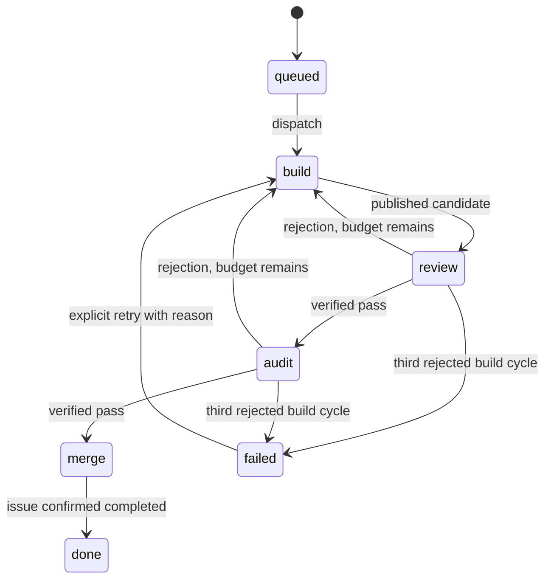

# Issue state machine and bounded rework

The issue lifecycle is defined in `forge/workflow_definition.py`. Worker execution,
assignment delivery and slot retirement are separate lifecycles. A rejected review
or audit is a completed attempt with a Build handoff, not an infrastructure failure.



`merge` describes the issue's final handoff, not permission to merge. Existing audit
policy, exact candidate checks, required human approvals and repository protections
continue to govern merging. A process exit or merged PR never proves issue completion.
Fresh GitHub observations can import progress that occurred between polls or outside
Forge; they cannot erase an exhausted issue retry budget.

## Three rejected build cycles

The default is **3 total rejected cycles**, shared across Review and Audit. The
initial build can be cycle one. Rejections belong to the preceding submitted Build
assignment; reviewing the same candidate twice does not create another build cycle.
A new Build assignment counts as a new cycle even when it publishes the same commit.
Provider migrations keep the assignment ID and do not consume an issue retry.

Verified published results bind the role, assignment, generation, PR, full head/base,
review ID, timestamp and body digest. They are recorded before admitting rework, and
also via verified retirement/reconciliation receipts. Each assignment result is
immutable and idempotent. The result, rejected-cycle record, failure latch and workflow
history/outbox event are committed in one SQLite transaction.

The third rejected cycle sets issue stage `failed`. All roles refuse new dispatch
for that issue. A failed candidate is skipped so another eligible issue in the same
repository can still be selected. Labels, restarts, newer snapshots, freed slots and
later PR revisions cannot reset that latch. Already-running work is preserved.

Tracked Audit admission requires a verified Review PASS for the exact current head
and base; relabeling cannot skip the review. Tracked rework requires a verified
rejection. Legacy untracked candidates retain the existing admission policy; Forge
does not fabricate old assignments or infer a failure count from worker prose.

## Explicit retry

Inspect the findings and preserved work first. When no assignment still owns the
issue, the operator can start a fresh budget with a durable reason and idempotency ID:

```sh
python3 -m forge.workflow_control retry-failed --config CONFIG --state STATE \
  --repo OWNER/REPO --issue 17 --reason 'Approved repair approach' \
  --event-id 'operator-retry-17-unique-request-id'
```

This retains all prior results and cycles in history and increments the retry epoch.
It does not clear holds, change GitHub labels, unquarantine a checkout, grant merge
permission, or immediately dispatch. Fresh eligibility checks must pass. Late
results from assignments created before the reset cannot consume the new budget.

## September 9 audit findings

The prior implementation persisted assignments and slots transactionally, but
reconstructed issue stages from queue labels and had no issue failure budget.
Execution quarantine preserved work, but was surfaced as if every preserved report
were a current failed issue. Release verification discarded published role outcomes
instead of recording them as durable issue transitions. A returned PR could become
eligible for its builder before the reviewer finished workspace cleanup.

This change records outcomes before rework admission, retains them through release
recovery, centralizes transition policy, enforces the shared retry budget, and shows
failed issues separately from operational workspace blocks. Busy workers with an
unverified issue link are labeled `Verifying assignment`.

The old blocked builder workspaces are a separate recovery problem: preservation
records do not expire automatically. Their issue status and historical attempt are
shown separately. This change does not delete preserved work or guess a legacy
assignment to clear those records.

## Rollout and validation

The schema is additive (`issue_retry_state`, `issue_results`, `rejected_build_cycles`).
Back up the live database with SQLite backup, not a raw copy of a WAL database. Deploy
all workflow modules together with admission paused; restart the status process to
load the new projection. Existing observed history is retained; no speculative
backfill is performed. A rollback to code without the retry gate could bypass a
recorded failure, so pause admission before rollback and retain the database.

Tests cover the requested mixed rejection path, three-cycle exhaustion, idempotent
receipts, exact revision/generation checks, admission gates, transaction rollback,
hold preservation, explicit retry, and provider migration. They use synthetic
GitHub responses and temporary state only.
