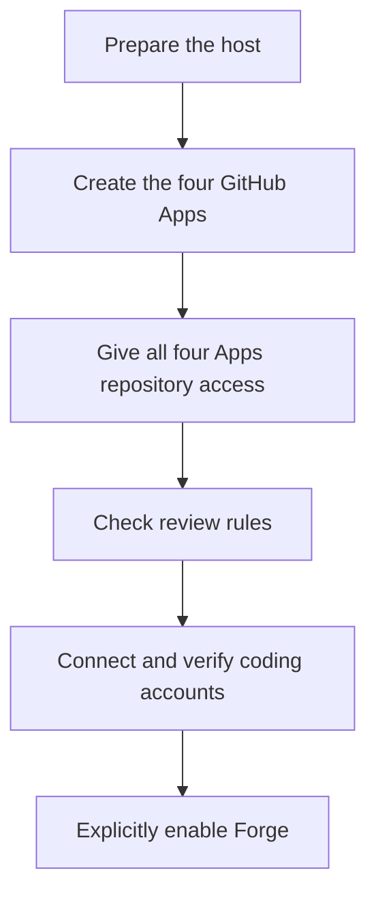
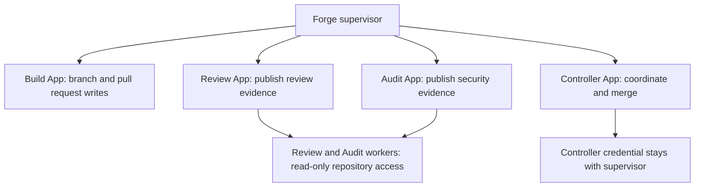

# Getting set up

Forge needs a running host, GitHub access and a coding account before it can work on issues. The setup screens check each part; work starts only when you choose **Start Forge** or **Enable automation** for a repository.

## Host installation

Start with the [host installation instructions](installation.md). The current release installs from a checkout on a prepared Linux host; the complete fresh-VM CLI wizard is still separate work, so do not assume `forge setup new` is available.

Open your Forge address after installation. Follow the [operator sign-in guide](operator-sign-in.md) if sign-in is not configured, then use **Onboarding** to finish GitHub and repository setup.

Keep administrator credentials on the operator's computer or in the trusted setup process. Forge's workers never need your personal GitHub administrator token.

## GitHub App creation

Onboarding starts at **GitHub**. Follow its App registration links, approve each GitHub manifest and install every App on the same selected repositories.

These are four reusable Apps, not four new registrations for every repository. The separate operator sign-in App identifies you; it does not grant repository access.

**Refresh access** checks existing installations. To grant access, use GitHub's installation settings, add the repository to all four Apps, then refresh in Forge.

## Add a repository

For the first repository, continue through Onboarding's **Repository** and **Start** steps. For another, open **Settings → GitHub access → Add repository**.

1. **Repository:** choose the repository you want Forge to manage.
2. **App access:** check that all four Apps can reach it.
3. **Review rules:** repair anything missing, then check again.
4. **Enable:** choose **Enable automation** when the checks pass.

Checking a repository, downloading a ruleset or leaving the wizard does not enable it. Access checks expire after five minutes; recheck if the screen asks.

## GitHub repository protection

The review baseline requires pull requests, two approving reviews and dismissal of stale approvals. The Controller App needs a pull-request bypass because Forge validates its own Review and Audit evidence; read-only workers do not supply GitHub's two native approving reviews.

If the baseline is missing:

1. Download the ruleset offered by Forge.
2. Import it in **GitHub → Repository settings → Rules → Rulesets**.
3. Review its target branch and bypass actors, then save.
4. Return to Forge and choose **Check setup** or **Check again**.

Keep this baseline separate from rules that enforce CI or other protections: a bypass applies to the entire ruleset. Existing organization rules and other repository requirements still apply.

GitHub sometimes hides bypass details from Apps. When Forge asks you to review them, confirm the actual Controller installation in GitHub; do not treat an unreadable setting as verified.

For existing protections, adjust the matched rule rather than importing duplicates. See the [protection reference](onboarding-reference.md#github-repository-protection) for exact fields and commands.

## Coding provider accounts

Forge ships Codex, Claude Code and Grok Build. Open **Settings → Coding accounts** and use the displayed host-terminal instructions to connect an account. Provider login is separate from GitHub App access and operator sign-in.

Back in Onboarding, **Verify repository** checks accounts and worker isolation. It makes small real model calls, which can consume provider usage; unchanged successful account checks can be reused for fifteen minutes.

Choose **Start Forge** when verification passes. Ready issues in enabled repositories can then enter the pipeline; see [How an issue moves](issue-state-machine.md).

## Configuration and recovery

Use **Settings** for repository access, accounts and factory configuration. If an issue shows **fix setup**, open it to read the specific problem before retrying.

- **Missing App access:** change the installation in GitHub, then refresh access.
- **Missing protection:** repair the rule, then check setup again.
- **Account unavailable:** reconnect or wait for the displayed cooldown in Coding accounts.
- **Host or isolation failure:** follow [installation troubleshooting](installation.md); verification must pass before work starts.

**Reset Forge** in Settings stops and fences work, checks cleanup and returns the installation to setup. It retains history in the selected SQLite runtime and does not undo published GitHub work; read the confirmation before using it.

A discovered deployment profile is a separate choice. **Confirm** starts observing that deployment; it is not needed merely to enable issue processing.

Continue with [How an issue moves](issue-state-machine.md), or use the [detailed setup reference](onboarding-reference.md) for host commands and protection repair.
