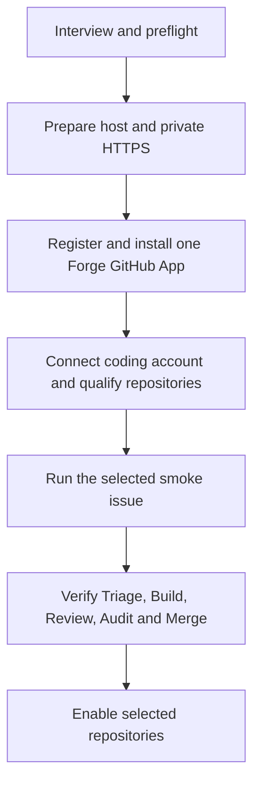

# Getting set up

Start a new factory from your computer with `forge install`. The CLI handles
remote installation, saves progress and prints each required browser action.
You do not need to SSH into the VM or copy configuration files yourself.

```sh
uv tool install 'git+https://github.com/XRPL-Commons/forge.git'
forge install --ssh anvil
```

`anvil` is an example SSH alias. See the [complete installation guide](cli-fresh-host.md)
for prerequisites, CLI installation, intent files and agent operations.



## What the CLI asks you to do

The interview records the GitHub owner, operators, repositories, merge policies,
coding accounts and smoke target. Review the preflight results and confirm Apply.
The CLI then guides the browser steps:

1. Approve the host joining your Tailscale network when required.
2. Create the Forge App from the supplied GitHub manifest and install it on the
   named repositories. GitHub may require your passkey.
3. Sign in to the selected coding provider using the displayed instructions.

Personal GitHub administrator credentials stay on your computer. The host stores
the Forge App's own credentials. The same App provides GitHub sign-in fallback;
the installing operator's observed Tailscale identity is linked to their GitHub ID.
Provider login is separate from operator sign-in and GitHub repository access.

Keep the CLI running during its local GitHub handoff. To inspect or resume:

```sh
forge install --ssh anvil --status
forge install --ssh anvil --resume --wait 3600
```

The saved installation and first-merge timer survive resume. Browser actions and
blockers are reported explicitly; resuming does not create a second installation.

## One App, independent workers

New installations register **one Forge App**. Build, Review, Audit and Controller
remain separate responsibilities; Review and Audit are produced by independent
workers. Their verdicts appear as `forge/review` and `forge/audit` checks, and
`forge/merge-policy` records the merge decision.

The default repository scope requires Forge Review and Audit for all pull
requests, including human-authored ones. A repository can instead select
Forge-created PRs only. Existing CI, signing rules and stronger protections remain
in force. Workflow-file edits are a separate repository permission, disabled by
default in the installation interview.

The CLI checks App access, branch rules, coding accounts, worker isolation and
signed publication. It qualifies the full database environment when repository
requirements need it. Provider verification makes real model calls and can consume
provider usage. See [GitHub setup](github-settings.md) for permissions and rules.

## The first merge and handover

While installation is pending, execution is limited to the exact smoke issue.
The default creates a private smoke repository and a separate publication-probe
repository. You can choose a real repository and optionally an existing issue.
These choices and their merge policies are part of the saved intent.

Triage must produce an accepted runnable disposition. An unchanged singleton
`keep` can be accepted under the installation consent through the normal
acceptance API. Questions, parking, closure and broader proposals require an
operator decision. Human merge approval and independent holds remain effective.

Completion requires real Build, Review and Audit evidence, worker cleanup, a
confirmed merge effect and an independent GitHub read of the exact merged PR and
completed issue. Only then does handover apply the selected repository policies
and enable the selected repositories. Disposable repositories remain available
for diagnosis with automation disabled.

A prepared host or passing automated tests do not establish that this live
installation acceptance has succeeded. The CLI reports the recorded proof and
time to first merge when the run completes.

## Existing factories and recovery

For an active factory, use **Settings** to manage repository access, accounts and
configuration. **Settings → GitHub access → Add repository** checks access and
rules before **Enable automation**. Checking or discovering a repository alone
does not enable it. Refresh expired checks when prompted.

Older factories may retain four role Apps and a separate sign-in App. Their
existing setup commands remain available; creating a new installation uses the
single-App flow above. See the [GitHub reference](github-settings.md) and
[host operations reference](installation.md) for existing installations.

**Reset Forge** in Settings fences work and returns the existing installation to
setup while retaining its SQLite history. A clean Forge reinstall is a separate
CLI operation with an explicit resource plan:

```sh
forge install --ssh anvil --reset --json
forge install --ssh anvil --reset --apply --reset-revision PLAN_DIGEST --json
```

The CLI archives the owned Forge installation after cleanup. It preserves SSH,
Tailscale, the operating system and GitHub objects. Read the
[reset procedure](cli-fresh-host.md#clean-reinstall-on-a-test-vm) before applying.

Continue with [How an issue moves](issue-state-machine.md).
