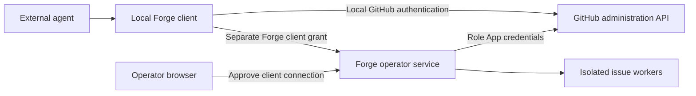

# External agents and repository setup

Status: credential boundary and first-release scope agreed, 2026-09-29.
Repository setup targets an existing Forge server. Fresh installation belongs in
a separate follow-up issue. Interfaces and connection details remain proposed. Related:
[#122](https://github.com/XRPL-Commons/forge/issues/122) (existing-server setup),
[#136](https://github.com/XRPL-Commons/forge/issues/136) (fresh installation),
[#15](https://github.com/XRPL-Commons/forge/issues/15) (operator sign-in),
[#77](https://github.com/XRPL-Commons/forge/issues/77) (operator audit).

## Product experience

The operator connects their external agent to Forge once, then asks:

> Set up XRPL-Commons/example in Forge and enable automation.

The agent uses a local Forge client to inspect readiness, grant the existing
Forge Apps access, prepare review rules, ask Forge to verify them, and enable
the repository. It reports the result and links to the same repository page
used by the operator UI. Later requests reuse this connection.

The client holds the authority to administer GitHub locally. Forge supplies its
requirements and verifies the result with its own Apps. The operator's GitHub
administrator credential never enters the Forge server or any worker.

The first release covers repository setup on an existing Forge instance.
Fresh-host installation and first App registration are a separate follow-up;
they are not acceptance requirements for the first release.

## 1. Responsibility and credential ownership

| Component | Responsibility | Credentials |
| --- | --- | --- |
| External agent | Interpret the operator's request; invoke documented client operations | Access to local tools under the operator's existing agent permissions |
| Local Forge client | Execute GitHub administration and coordinate Forge setup | Separate Forge client grant; use local `gh` authentication for GitHub |
| Forge server | Publish requirements, observe App access and protection, enforce activation checks | Existing role App keys and coding-provider credentials; client-grant records |
| Forge worker | Execute its assigned issue work | Existing per-job scoped credentials |

The local client is installed on the operator's computer. It talks directly to
GitHub for administrative changes, and separately to Forge for factory actions.
It does not install itself or copy the operator's GitHub authentication onto the
Forge host. The existing `bin/forge setup/update/service` commands remain host
administration interfaces.



The first client uses `gh api` as its GitHub credential broker. It does not run
`gh auth token`, accept an administrator token in a Forge request, or print
credentials. GitHub login remains local. The client reports missing permissions
and provides the appropriate login or browser action without silently expanding
access. `gh` supports authenticated API requests and local credential storage;
its documented environment overrides must be handled explicitly.
[GitHub CLI API](https://cli.github.com/manual/gh_api),
[authentication](https://cli.github.com/manual/gh_auth_login),
[environment](https://cli.github.com/manual/gh_help_environment).

This is a separation between computers and services. It does not sandbox an
external agent that already has general shell access to the operator's machine.
Revoking a Forge connection revokes access to Forge; GitHub credential revocation
remains a separate local/GitHub action.

## 2. Connect once

Proposed client commands (these do not exist yet):

```sh
forge connect https://forge.example --name personal
forge auth status --instance personal
forge doctor --instance personal
forge disconnect --instance personal
```

Connection opens a browser approval page, showing the instance, client name,
requested capabilities, repository scope and a matching short code. The client
can also return the link/code as structured output for an agent to relay.
The short-lived device challenge expires after ten minutes and is consumed once.
The private polling credential stays in the client; displaying the short code
alone cannot redeem a connection. Polling is bounded and rate limited. Use an
established device authorization implementation following
[RFC 8628](https://www.rfc-editor.org/rfc/rfc8628), with tests for denial, expiry,
replay and authorization-pending/slow-down responses.

**An authenticated, explicitly authorized operator approves the connection.**
Forge currently has a trusted-network dashboard with no per-user login. The
existing UI action token and upstream secret are not client login credentials.
The operator identity and session work in #15 is a prerequisite for this browser
approval flow. Signed-in GitHub identity alone must not grant operator access.
Use a separate identity-only sign-in; it requests no repository administration
scope and does not consume the CLI's GitHub token.

The first administrator is configured through the existing trusted host setup
path, with explicit allowed GitHub account IDs and a recovery procedure. A
visitor cannot claim first-admin status from an empty dashboard. Implementation
must complete this bootstrap and protect existing operator routes as well as
new client routes before enabling client pairing.

Store the Forge refresh credential in the local OS credential store. Keep
instance URL/ID and non-secret settings in the client config. Use short-lived
opaque access tokens (15 minutes) with rotating refresh credentials (30 days
idle, 90 days absolute), hashed server-side. Token redemption and rotation are
atomic; replay revokes the affected token family. A lost rotation response may
require reconnecting rather than returning an old credential. Routine repository
setup reuses the connection; expiry or revocation may require reconnection.

All client traffic uses verified HTTPS, including on a tailnet. A current
HTTP-only installation needs TLS termination before pairing is offered. Plain
HTTP is restricted to explicit local development on loopback. Credentials are
bound to the selected instance, with cross-origin redirects rejected.

### Client capabilities

The initial agent setup preset requests:

- `repositories:read`: requirements, readiness and operation status.
- `repositories:prepare`: refresh access and request verification.
- `repositories:activate`: enable/disable automation.

Bind grants to selected repository IDs or an explicitly approved GitHub owner
for adding new repositories. Resolve owner names to stable IDs. A repository
transfer invalidates an owner-scoped authorization until re-evaluated. Enforce
the current operator authorization, client grant, instance generation and target
on every request. Client grants cannot create other grants or access secrets,
reset, host commands, worker controls, or generic factory actions.

A read-only preset serves only reads; capabilities are enforced on the server.
The UI lists connected clients, scopes, creation/expiry, last use and Revoke.
Removing the operator's access, reset, logout/revocation or token-family replay
invalidates affected grants. A revoke stops subsequent steps; an already accepted
GitHub write may still finish and is reconciled on the next authorized run.

## 3. Repository workflow

Agent-facing convenience command:

```sh
forge repo setup XRPL-Commons/example --instance personal --apply --enable --json
```

`--apply` authorizes the supported GitHub preparation changes for this target.
`--enable` explicitly requests activation after verification. Without `--apply`,
return the plan; without `--enable`, stop at verified readiness. Commands never
wait for terminal input in JSON/non-interactive mode. The agent maps the
operator's instruction to these options; an already authorized setup does not
require separate confirmation for each routine step. An ambiguous activation
request stops at ready, with activation as the next available action.

### Sequence

1. **Inspect locally.** Resolve the requested owner/name through GitHub, record
   immutable repository and owner IDs, default branch and administrative access.
   Fetch only needed fields; keep arbitrary GitHub responses out of Forge RPC.
2. **Get Forge requirements.** Fetch the role App IDs, observed installations,
   required permissions and protection requirements. Bind the plan to instance
   generation, configuration revision, repository identity and default branch.
   An undiscovered repository may be planned from local identity evidence, but
   Forge treats that evidence as a hint until its Apps can observe the repository.
3. **Prepare a concrete plan.** Combine Forge requirements with fresh GitHub
   state. List exact access grants, rule changes, already satisfied requirements
   and any browser actions. Save its revision/digest and expiry locally.
4. **Apply GitHub changes locally.** Grant only this repository to the expected
   Apps; add the required review baseline when missing. Recheck preconditions
   immediately before each write. Record completed steps in a private local
   journal containing IDs/digests, never credentials or raw authentication output.
5. **Ask Forge to verify.** Refresh App inventories and check effective review
   protection through Forge's own credentials. Return a durable operation ID;
   bounded waiting reports progress and can resume after interruption.
6. **Enable when requested.** Send the current configuration revision and
   verification identity. Forge rechecks freshness and readiness under its
   existing settings lock before enabling. Return the repository page URL and
   whether the repository is ready or enabled.

Enabling an active repository can start work on already eligible issues under
existing factory policy. The plan and result state this consequence. Setup does
not independently label issues ready, select per-issue environments or launch a
test job. Environment selection remains the supervisor's existing responsibility.
Deployment-profile discovery continues through the existing repository lifecycle;
this client does not silently confirm a deployment proposal.

### GitHub constraints and preservation

GitHub documents the add-repository-to-installation endpoint as requiring a
classic PAT with `repo` scope and repository admin access; it excludes App and
fine-grained tokens. A normal `gh` login therefore cannot be assumed sufficient.
When the endpoint is unavailable, report the exact GitHub installation link and
resume after the operator grants access. Initial installation is also a browser
handoff. Existing all-repository installations need no additional grant.
[GitHub installation API](https://docs.github.com/en/rest/apps/installations#add-a-repository-to-an-app-installation).

Never replace an installation's entire repository selection or remove grants.
If several installations are plausible, report the choice with account/App IDs;
do not guess. Verify proposed App identities and permissions against GitHub and
the locally pinned connection before granting access. Changing those identities
requires a new reviewed plan, not automatic continuation.

Read effective protection before writing. Preserve organization rules, stricter
reviews, checks, bypass actors and unrelated rulesets. If effective protection
already meets Forge's requirements, leave it alone. Otherwise, create an
additive baseline using the existing `ruleset(branch)` requirement. Updating a
previously created baseline requires its recorded ID and unchanged prior digest;
a matching name alone is not ownership. An ambiguous collision or a change that
would weaken protection returns a conflict. Recheck GitHub support/permissions
and distinguish unavailable enforcement from a missing rule. Forge verifies the
result independently.
[GitHub rules API](https://docs.github.com/en/rest/repos/rules#create-a-repository-ruleset).

The client returns to `blocked` if a rule cannot be applied with its local
permissions. It does not grant Forge's Apps administrative write permissions to
work around that failure. Label creation can be an explicit typed step when
needed; existing label meanings/colors and issue assignments are preserved.

## 4. Typed plans and safe resumption

The server returns domain requirements, not shell commands to run locally. The
client implements a small fixed action set, initially:

- `github.installation.add_repository`
- `github.ruleset.ensure_baseline`
- `github.label.ensure` (when required)
- `forge.repositories.refresh`, `verify`, `enable`, `disable`

Each action has a closed JSON schema. Reject unknown fields, executable strings,
arbitrary endpoints/headers, credential fields and callbacks. Resolve GitHub API
paths from validated target IDs and names in trusted client code. The GitHub host
is selected at connection time; v1 supports github.com. The client uses fixed
`gh api --hostname github.com` argument arrays and structured stdin payloads,
never shell evaluation or command text from Forge, a repository, or an agent's
plan file. Do not propagate administrative environment variables to any remote
operation, and do not dump child-process environments or authorization headers.

The same allowlisted operations serve CLI and future MCP. UI requests call the
same server service, with the same verification and revision checks.

Plan validity is ten minutes and is shortened by any changed generation,
configuration, target identity/default branch, App identity or rule precondition.
Replanning after a stale observation is read-only. A changed write set is returned
for the agent to compare with the operator's authorized request; `--yes` cannot
bypass failed verification or broaden that request.

Both sides journal work. Client setup state records the bound target, desired
end state and completed GitHub steps. Server operation state records client and
operator IDs, target, revision, request ID, stage, timestamps and result. Workers
never receive this client journal or its credentials.

- A stable request ID plus identical body returns the same server operation;
  reuse with a different body fails.
- GitHub writes have no assumed universal idempotency key. Following timeout or
  disconnect, re-read state before retrying. Installation grants are reconciled;
  ruleset creation is matched to the recorded desired state. Ambiguity stops.
- A disconnected CLI can retrieve operation status and resume remaining steps.
- Restarted verification is marked interrupted and rerun using fresh observations.
- Reset changes the instance generation and fences old plans, operations and grants.
- There is no automatic rollback removing App access or protection after a partial
  failure. Report the completed changes and outstanding blocker.
- A cancelled/expired grant stops new actions. The CLI checks authorization before
  starting a local administrative step; this does not revoke its GitHub credential.

## 5. Interfaces

Use a standalone local `forge` client executable with no requirement for a Forge
checkout, Docker, a local server runtime or an SSH login. Keep packaging and
client imports separate from the Linux host runtime. The first supported clients
are macOS and Linux; Windows is a follow-up qualification target.

| Command | Purpose |
| --- | --- |
| `forge connect URL` | Authenticate and save a named instance |
| `forge auth status`, `forge disconnect` | Inspect or revoke this connection |
| `forge doctor` | Check client version, Forge connectivity, scopes and local GitHub capability |
| `forge commands --json` | Versioned command schemas, effects and examples |
| `forge repo inspect OWNER/REPO` | Current readiness and blockers |
| `forge repo plan OWNER/REPO` | Exact proposed changes; no administration writes |
| `forge repo apply PLAN_ID` | Execute a current, locally recorded plan |
| `forge repo verify OWNER/REPO` | Request fresh server verification |
| `forge repo enable OWNER/REPO` | Enable after current verification |
| `forge repo disable OWNER/REPO` | Stop new work through the existing narrow action |
| `forge repo setup OWNER/REPO --apply [--enable]` | Coordinate the above steps |
| `forge operation status ID`, `forge operation wait ID` | Inspect or wait with a bounded deadline |
| `forge agent install` | Install the shared skill into supported detected agent locations |
| `forge mcp` | Later: local stdio tools wrapping these same client operations |

JSON commands emit one result on stdout; progress goes to stderr. Include schema
version, stable status/error code, target, operation/plan IDs, revision, completed
steps and machine-readable next actions. Do not include credentials. For example:

```json
{
  "version": 1,
  "status": "needs_user_action",
  "code": "github_installation_access_required",
  "repository": {"id": 123, "name": "XRPL-Commons/example"},
  "completed": ["repository_resolved"],
  "next_actions": [{
    "kind": "open_url",
    "url": "https://github.com/organizations/XRPL-Commons/settings/installations/456",
    "reason": "Grant the existing review App access to this repository"
  }]
}
```

Exit codes: 0 requested end state reached; 2 usage/schema error; 3 authentication
or authorization missing; 4 user/browser action needed; 5 stale plan/conflict;
6 verification blocker; 7 transient upstream failure; 8 accepted operation still
running at the wait deadline. `status` and `code` carry the detailed distinction.

Add `/api/operator/v1` behind the existing frontend, using a dedicated Bearer
authentication path and bounded schemas. Initial routes cover instance
capabilities, requirements, repository state, verification operations and narrow
activation actions. Device authorization/token endpoints follow their protocol;
all other reads/writes require a grant. Validate tokens server-side before
service dispatch; the UI-to-Python upstream secret only authenticates the proxy.
Preserve the existing browser session/CSRF protections and never expose that
upstream secret or a browser action token to the client.

Public pairing endpoints reveal only instance identity and protocol capabilities,
rate limit attempts and never return private repository state. API version and
supported action schemas are negotiated before planning. Client/server version
mismatch returns a specific upgrade instruction; unknown operations fail closed.

## 6. Agent skill and UI

The skill teaches the workflow, command discovery, authorization boundaries,
status codes, resumption and final reporting. It never asks an agent to read or
paste tokens. Support JSON/non-interactive use from the start. Install a shared
skill once with ownership markers; update only Forge-managed files and leave
existing user-authored skills intact. HEY provides a useful precedent for command
discovery, structured results, managed skills and optional local MCP.
[HEY agent documentation](https://github.com/basecamp/hey-cli/blob/main/docs/agents.md).

The UI gains **Settings → Agent connections** with a connect guide, pending
approvals, granted access and revoke. Repository pages show the same readiness
and operation progress regardless of whether setup started in the UI or CLI.
Expose actor/client and completed steps in operation history; client-reported
GitHub changes are labeled as reports, while Forge's verification is separate.

MCP runs locally so administrative credentials remain on the operator's computer.
It calls the same client library and respects the granted scope. A read-only MCP
mode also disables local GitHub writes. Deleting MCP write tools alone does not
limit an external agent's separately authorized shell access.

## 7. Fit with current implementation

- `forge/repository_setup.py`: reuse `view`, `ruleset`, `check`, `enable`,
  `disable`, and the five-minute protection freshness rule. Extract durable
  verification operations around the present background-thread entry point.
- `forge/settings.py`: retain revision checks, access expiry and config locks;
  add explicit service selection rather than client filesystem knowledge.
- `forge/onboarding.py`: preserve generation fences and the existing requirement
  that each role has a distinct App. Fresh onboarding remains a later increment.
- `legacy/forge-status.py` and `ui/server/utils/proxy.ts`: add the separately
  authenticated operator API adapter; reuse service functions rather than
  manufacturing browser cookies/origin headers in the local client.
- New client package: command parser, transport, typed plan executor, local `gh`
  adapter, credential-store integration and restartable journal. It imports no
  worker-launch, App-key or host-installation modules.
- New server modules: operator identity/session authorization, client grants,
  operation journal and the bounded operator API. Audit records cover actor,
  target, action and result without secret values; coordinate with #77.

## 8. Release sequence and acceptance

1. **Connection foundation:** finish the required operator identity, first-admin
   bootstrap, TLS and client approval/revocation. Ship read-only inspect/doctor.
2. **Repository setup:** plan/apply/verify/enable/disable, local GitHub adapter,
   durable operations and the shared skill. Prove the happy path with an existing
   factory and a repository invisible to all Apps at the start.
3. **Fresh installation ([#136](https://github.com/XRPL-Commons/forge/issues/136)):** expose initial owner/App registration and first start
   using shared onboarding services. Keep host install an explicit separate
   capability. App manifest codes are one-use, generation-bound and tied to the
   authenticated client intent; exchange only for Forge-owned App credentials.
   Browser registration/installation steps return resumable links. Do not reuse
   the browser cookie as a CLI identity or print manifest conversion secrets.
   [GitHub manifest flow](https://docs.github.com/en/apps/sharing-github-apps/registering-a-github-app-from-a-manifest).
4. **MCP and broader operations:** wrap the client library after the first workflow
   is stable; add issue inspection/control through separately defined capabilities.

Required tests for the first write-capable release:

- End-to-end local client → mock GitHub plus Forge service → verified activation;
  repeated setup performs no unnecessary GitHub mutations.
- A synthetic operator token appears only in calls to the mock GitHub origin.
  Capture Forge requests, server files, logs, client stdout/stderr and worker
  inputs; assert the token is absent. Include failures and debug output.
- A hostile requirement/plan cannot change GitHub hosts, target IDs, App identity,
  permissions, headers or local command execution beyond the supported schema.
- Unsupported token type, missing admin rights, SSO/org restrictions and first
  installation return resumable browser actions or specific blockers.
- Existing stronger/org protection and unrelated App grants survive setup.
  Name collisions and concurrent ruleset edits cannot silently replace rules.
- All-four-App access and fresh effective protection are required by both UI and
  CLI activation. Missing, expired or client-asserted checks cannot enable work.
- Scope violations, unauthorized operators, session expiry, revoked clients,
  reset generations and device/refresh replay fail before dispatch.
- Timeouts during GitHub writes, duplicate server requests, CLI/server restarts
  and changed plans recover without duplicated rulesets or silent activation.
- An external agent completes setup with one prior connection approval and only
  GitHub-required human steps. The operator does not copy secrets or edit config.

## Remaining design decision

Existing-instance repository setup is the confirmed first release. The main
tradeoff is browser-based client connection: it requires the operator sign-in
and TLS foundation. A local/SSH-only prototype could prove the setup executor
sooner, but would not deliver the proposed end-user connection experience.

The credential boundary is fixed regardless of release order: administrative
GitHub operations run locally, and Forge independently verifies the result.


## Implementation progress

The first implementation adds the closed requirements contract and local
preparation engine (`forge_client/README.md`). Integration tests drive the real
Forge verification/activation services with a separate local GitHub broker.
Connection/authentication, durable operation journals, CLI distribution and the
agent skill remain integration work. No external-client HTTP endpoint is enabled
by this foundation, and #122 remains open until the full workflow is available.
